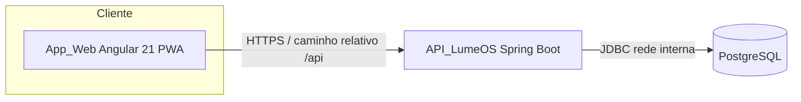
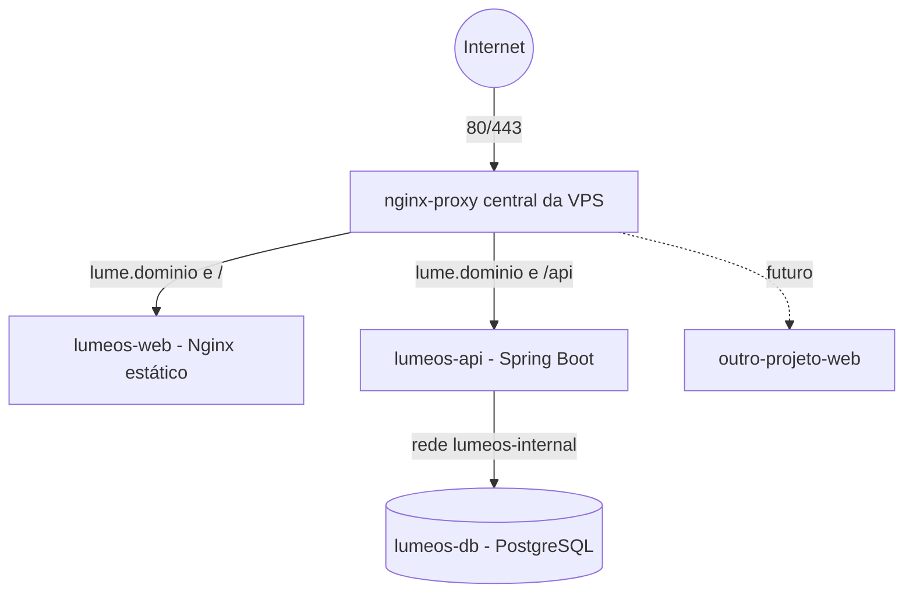
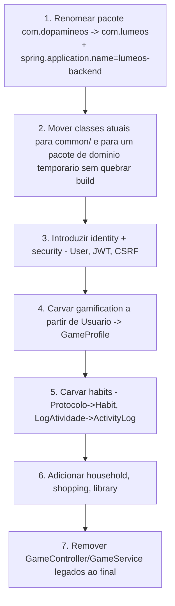
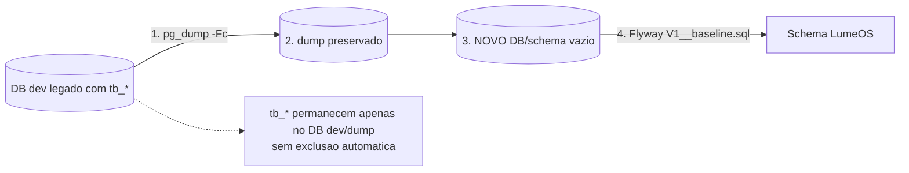
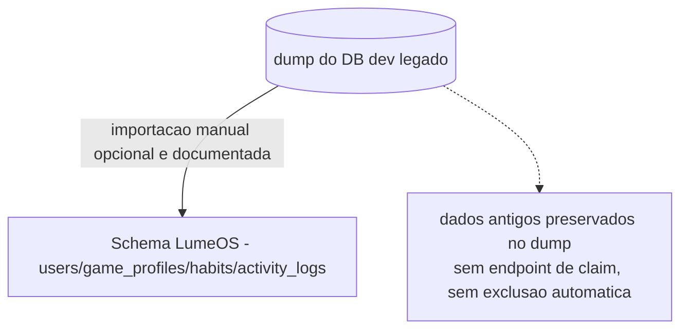
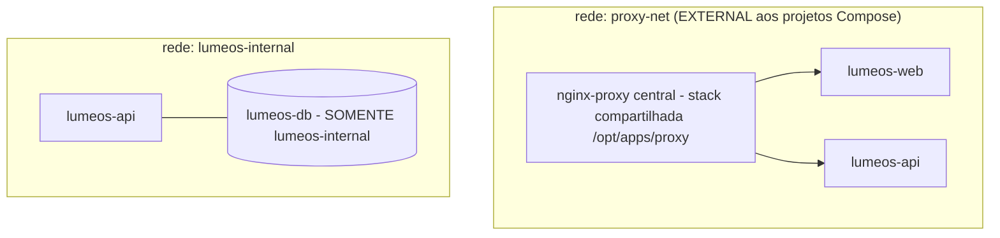
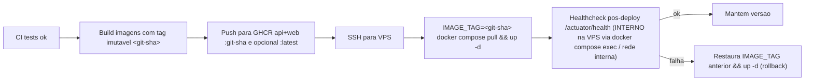
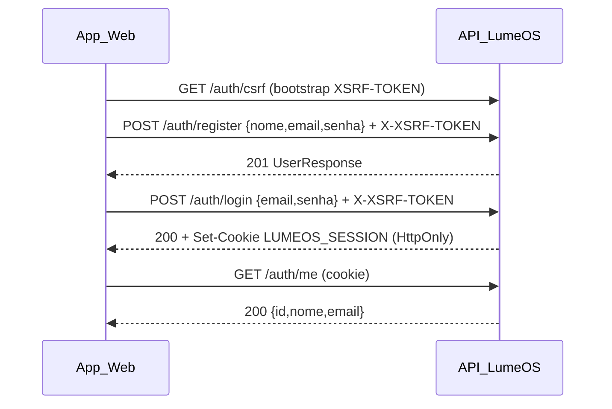
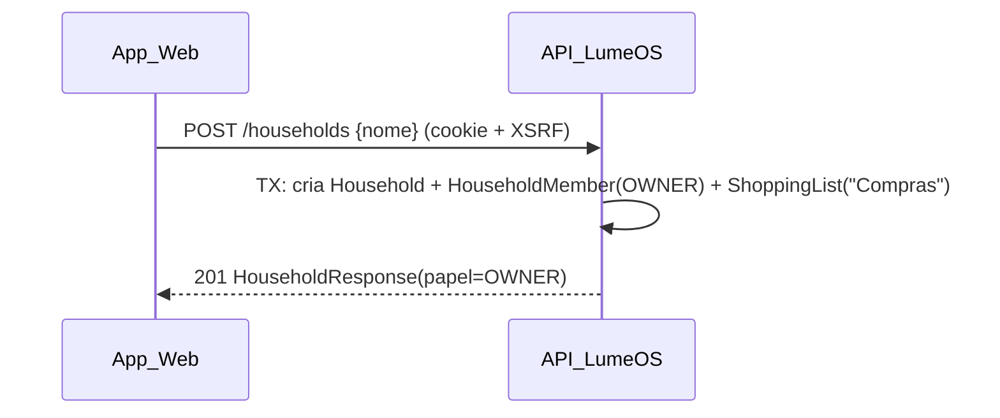

# Design Document

LumeOS (MVP) — Documento de Design

## Overview

Este documento transforma os requisitos aprovados (REQ-001..REQ-026, RNF-01..RNF-16) em uma arquitetura concreta e implementável para o projeto **existente** (atualmente chamado DopamineOS). O objetivo é evoluir o produto para o **LumeOS**: um hub pessoal e compartilhado com três módulos (Rotina/Hábitos gamificados, Lista de Compras compartilhada, Lista de Leituras) sobre fundações de identidade, autenticação, household, autorização, persistência versionada, PWA e deploy em VPS.

Princípios que guiam todo o design:

- **Refatoração incremental in-place**, no mesmo repositório, preservando o histórico Git. Sem reescrita big-bang. A aplicação deve permanecer compilável e funcional em cada passo da migração.
- **Preservar o comportamento funcional existente**: gamificação (classes, atributos, XP, nível, HP/MP, moedas), gráfico radar (ApexCharts), CRUD de hábitos, check-in e histórico. Nenhuma funcionalidade útil é perdida.
- **Monólito modular** (nada de microserviços, Redis, RabbitMQ, Kubernetes, Supabase/Firebase). Stack mantida: Spring Boot/Java 21/JPA/PostgreSQL/MapStruct/Lombok/Maven no backend; Angular 21/RxJS/Tailwind/ApexCharts no frontend; Docker/Compose/VPS/Nginx/Let's Encrypt na infra.
- **Separação explícita** entre **Estado atual**, **Estado alvo** e **Estratégia de migração** ao longo de todas as seções.
- **Toda decisão arquitetural relevante carrega justificativa.**

O documento está organizado em 38 seções. As seções 1 (esta, `## Overview`) e o título do documento (`# Design Document`) usam os cabeçalhos canônicos exigidos pelo validador; o restante do corpo e os títulos de seção estão em pt-BR.

---

## 2. Estado atual do projeto

Esta seção descreve o código verificado (ground truth), separando-o do estado alvo das próximas seções.

### 2.1 Backend (verificado)

- **Stack:** Spring Boot 3.3.1, Java 21. Maven `groupId=com.dopamineos`, `artifactId=backend`, `name=backend`. Pacote `com.dopamineos.backend`.
- **Organização em camadas horizontais:** `config`, `controller`, `dto`, `entity` (+ `entity.enums`), `exception`, `mapper`, `repository`, `service`.
- **Entidades:**
  - `Usuario` (`@Table tb_usuario`) — **conflita identidade + personagem + progressão** em uma única entidade: `id, nome, classe(ClasseRPG), nivel=1, xpAtual=0, xpParaProximoNivel=100, moedas=0, forca, destreza, intelecto, carisma, constituicao, hpAtual, maxHp, mpAtual, maxMp`. Métodos de negócio:
    - `ganharXp(int)`: aplica **uma única** subida de nível (`if xpAtual >= limiar` uma vez). **Limitação:** o alvo exige um laço `while` para múltiplas subidas (REQ-006).
    - `subirNivel()`: `xpAtual -= limiar`, `limiar = (int)(limiar * 1.5)`, cura total.
    - `resetarPersonagem(nome, classe)`: define atributos por classe (`GUERREIRO` 10/5/3/5/10, `MAGO` 3/5/10/6/4, `LADINO` 5/10/5/8/5), `maxHp = constituicao*10`, `maxMp = intelecto*10`.
  - `Protocolo` (`@Table tb_protocolos`): `id, nome, icone, cor, descricao, atributo(Atributo), dificuldade(Dificuldade), duracaoMinutos, @ManyToOne Usuario`.
  - `LogAtividade` (`@Table tb_log_atividade`): `id, nomeMissao, icone, xpGanho, duracaoMinutos, dataHora(LocalDateTime), @ManyToOne(nullable=false) Usuario`.
- **Enums:**
  - `ClasseRPG {GUERREIRO, MAGO, LADINO}` — possui `getMultiplicador(Atributo)` retornando 1.0/1.3/1.5, mas **não é usado** por `GameService` (código morto; documentado aqui).
  - `Atributo {FORCA, DESTREZA, INTELECTO, CARISMA, CONSTITUICAO}`.
  - `Dificuldade {EASY(10,2,1), MEDIUM(30,5,2), HARD(60,15,3), EPIC(100,50,5)}` com `xpBase, goldBase, pontosAtributo`. **`pontosAtributo` não é usado** por nenhum comportamento (confirmado em `GameService`): o check-in concede apenas XP e moedas. O campo existe mas será **descartado das recompensas** no alvo.
- **GameService (verificado):**
  - `getPerfil()` = `usuarioRepository.findAll().stream().findFirst()` → modelo **single-player** sem autenticação.
  - `setup()` **apaga TODOS** os logs, protocolos e usuários e recria (destrutivo).
  - `fazerCheckin(protocoloId)`: `getPerfil` → busca `Protocolo` por id → XP/gold da `Dificuldade` → `ganharXp` + `moedas += gold` → salva `LogAtividade` (`dataHora = now()`) → salva `Usuario`.
  - `criarMissoesPadrao(usuario)`: deck padrão de 6 hábitos.
- **GameController** `@RequestMapping("/api/v1/game")`: `GET /perfil`, `GET /protocolos`, `POST /setup`, `POST /protocolos`, `POST /protocolo`, `DELETE /protocolo/{id}`, `POST /checkin/{id}`, `GET /historico`. Usa MapStruct `GameMapper` → `UsuarioDTO`, `ProtocoloDTO`, `LogAtividadeDTO`; `SetupRequest(nome, classe, List<ProtocoloDTO> missoes)`. Sem vazamento de entidade. `ProtocoloDTO` valida `@NotBlank nome`, `@NotNull duracaoMinutos/atributo/dificuldade`.
- **GameLoader** (`CommandLineRunner`): se `usuarioRepository.count() == 0`, cria "Alex, o Paladino" (`GUERREIRO`) + deck padrão. **Não pode rodar em produção.**
- **GlobalExceptionHandler** `@ControllerAdvice`: `ResourceNotFoundException → 404`, `Exception → 500`; corpo `StandardError {Instant timestamp, Integer status, String error, String message, String path}`.
- **application.properties:** `spring.application.name=dopamine-backend`; datasource `jdbc:postgresql://localhost:5432/postgres`, user `postgres`, senha `123456` (**hardcoded**); `ddl-auto=update`; `show-sql=true`; `format_sql=true`; dialect PostgreSQL; `server.error.include-message=always`, `include-binding-errors=always`, `include-stacktrace=always`. **Sem Flyway.** Actuator presente. Dependência **TestNG 7.7.0 presente mas não usada** (só JUnit 5 em `BackendApplicationTests.contextLoads`).
- **CorsConfig:** `allowCredentials=true`, origens **apenas** `http://localhost:4200`, métodos GET/POST/PUT/DELETE/OPTIONS, headers `*`.

### 2.2 Frontend (verificado)

- Angular 21 standalone (package `frontend`). Deps: `@angular/* ^21`, `apexcharts ^5.3.6`, `ng-apexcharts ^2.0.4`, `rxjs ~7.8`, `zone.js ^0.16`, `tailwindcss ^3.4.17` (devDep), `vitest ^4` (test).
- **Estrutura plana** `src/app/`: `app.ts` (`App`, selector `app-root`, `RouterOutlet`), `app.config.ts` (`provideRouter` com `withViewTransitions`, `provideAnimations`, `provideHttpClient(withFetch())`, `provideZoneChangeDetection`), `app.routes.ts`, `app.html`, `app.css`, `app.spec.ts`, `services/game.service.ts`, `components/{setup, dashboard, quest-editor, history, sidebar}`.
- `game.service.ts`: **`apiUrl='http://localhost:8080/api/v1/game'` hardcoded**; espelha enums/interfaces do backend e métodos `getPerfil, getProtocolos, criarProtocolo, salvarMissoes, deletarProtocolo, fazerCheckin, setup, getHistoricoGeral`.
- **Rotas:** `'' → redirect 'setup'`; `setup`, `dashboard`, `game/quest-editor`, `history`; wildcard → `dashboard`; títulos "DopamineOS - ...".
- **SidebarComponent:** menu com termos de RPG (Visão Geral 🏰, Grimório de Missões 📜, Histórico ⏳); `logout()` é **apenas visual** (navega para `/setup`, `localStorage.clear()` comentado).
- **Ausências:** sem guards, sem interceptor, sem PWA, sem `proxy.conf`. `angular.json` presente. Docs README/SETUP/TUTORIAL com marca DopamineOS/RPG.

### 2.3 Resumo do estado atual

O produto é um RPG de hábitos **single-player**, sem autenticação, com uma entidade `Usuario` sobrecarregada, operação `/setup` destrutiva, URL de API e credenciais fixas, sem versionamento de schema, sem isolamento de dados e sem infraestrutura de deploy segura. É funcional e tem mecânica de gamificação valiosa a preservar.

---

## 3. Problemas arquiteturais encontrados

| # | Problema (estado atual) | Impacto | Requisito que corrige |
|---|---|---|---|
| P1 | Sem autenticação; `getPerfil()` usa `findAll().findFirst()` | Inseguro na internet; impossível multiusuário | REQ-001, REQ-004 |
| P2 | `Usuario` mistura identidade + personagem + progressão | Impede multiusuário e evolução; acoplamento | REQ-002 |
| P3 | `/setup` apaga TODOS os dados globais | Perda de dados; destrutivo | REQ-007, REQ-012, RNF-15 |
| P4 | `GameLoader` cria usuário falso ao subir | Dados fantasmas em produção | REQ-005, REQ-012 |
| P5 | `ganharXp` sobe **um** nível por chamada | Divergência da regra alvo (laço) | REQ-006 |
| P6 | `ddl-auto=update`, sem Flyway | Schema não versionado; inseguro em prod | REQ-014 |
| P7 | Credenciais e `JWT`/segredos hardcoded | Segredos versionados; inseguro | REQ-015, RNF-14 |
| P8 | CORS fixo em `localhost:4200`; `apiUrl` absoluto no frontend | Impede produção/mesma origem | REQ-016, REQ-017 |
| P9 | Prefixo único `/api/v1/game` | Não acomoda novos domínios | REQ-013 |
| P10 | Sem isolamento por usuário/household | IDOR; vazamento de dados | REQ-004, RNF-04/05 |
| P11 | Logout apenas visual; sem guards/interceptor | Sessão insegura no frontend | REQ-018 |
| P12 | Sem PWA, sem Docker, sem reverse proxy/HTTPS, sem backup/CI | Não implantável com segurança | REQ-019..REQ-025 |
| P13 | Marca DopamineOS/RPG espalhada; pacote `com.dopamineos` | Identidade incorreta do produto | REQ-026 |
| P14 | `pontosAtributo` e `ClasseRPG.getMultiplicador` são código morto | Confusão; recompensa inexistente | REQ-006, REQ-007 |
| P15 | TestNG presente mas não usado | Dependência inútil; duas libs de teste | REQ-023, Estratégia de testes |
| P16 | `LogAtividade.dataHora` é `LocalDateTime` (sem fuso) | Diverge da convenção de tempo | REQ-009 convenção, REQ-014 |

---

## Architecture

> Esta seção e as seções 4–7, 25–28 descrevem a arquitetura.

## 4. Arquitetura alvo

### 4.1 Visão conceitual



O App_Web chama a API sempre por caminho **relativo** `/api/v1/...` (mesma origem). O backend é um **monólito modular** organizado por domínio. O banco só é acessível pela rede interna.

### 4.2 Visão de produção (VPS com gateway central)



**Decisão e justificativa:** apenas o **nginx-proxy central** publica 80/443. Ele roteia por domínio, o que permite que a **mesma VPS hospede outros projetos no futuro** sem disputa de portas (cada projeto registra seu domínio no gateway). `lumeos-web`, `lumeos-api` e `lumeos-db` **não publicam portas públicas**.

**Dois níveis de Nginx — não é redundância:**
- O **nginx-proxy central** é o **gateway/reverse proxy da VPS**: termina TLS, roteia por domínio, aplica rate limiting e redireciona HTTP→HTTPS.
- O **Nginx interno do `lumeos-web`** é **apenas um servidor de arquivos estáticos** do bundle Angular (`dist/`). Ele não faz proxy reverso para a API; só entrega o app shell. Isso é padrão em SPA containerizada e **não** constitui duas camadas de reverse proxy redundantes.

### 4.3 Camadas lógicas

- **Frontend (App_Web):** apresentação, roteamento, guards, estado de sessão, PWA.
- **Backend (API_LumeOS):** controllers REST por domínio → services (regras) → repositories (JPA) → PostgreSQL. Segurança transversal (JWT + CSRF + autorização por titularidade derivada do token).
- **Persistência:** PostgreSQL com schema versionado por Flyway.

---

## 5. Decisões arquiteturais e trade-offs

| Decisão | Alternativa descartada | Justificativa |
|---|---|---|
| Monólito modular por domínio | Microserviços | MVP de dois usuários; simplicidade de deploy/operação; evita Redis/RabbitMQ/K8s (fora de escopo) |
| Mesma origem via proxy central (`/` web, `/api` api) | CORS cross-origin em produção | Simplifica cookies/CSRF/CORS; cookie `SameSite=Lax` suficiente |
| JWT **HS256** em cookie HttpOnly | RS256; sessão em servidor; token em `localStorage` | HS256 é mais simples para MVP (um segredo forte); HttpOnly protege contra XSS; RS256 documentado como evolução |
| CSRF double-submit (`CookieCsrfTokenRepository`) habilitado | `csrf.disable()` | Obrigatório pelos requisitos; JWT em cookie exige CSRF para mutações |
| Flyway sobre **schema vazio** + `ddl-auto=validate` (prod) | `ddl-auto=update` | Schema versionado, previsível e seguro em produção; Flyway começa do zero com `V1`, sem baseline |
| Banco atual tratado como **banco de desenvolvimento legado**; LumeOS roda em um **novo banco/schema vazio** com `V1__baseline.sql` | `baselineOnMigrate` sobre tabelas `tb_*` | O LumeOS inicia em schema vazio, então **não há necessidade de baseline**; o schema novo é estruturalmente diferente; dados legados preservados por `pg_dump` e importação manual opcional documentada |
| HS256 sem `householdId` no token | Incluir `householdId` no JWT | Household derivado de `HouseholdMember` evita sessão obsoleta |
| `shopping_items` sem `household_id` | Duplicar `household_id` no item | Evita redundância que permita inconsistência; household derivado via `shopping_list_id → shopping_lists.household_id` |
| **Locking otimista obrigatório** em `GameProfile` (`@Version` + coluna `version`) **com retry limitado** no check-in | Last-write-wins; sem controle de concorrência | Check-in acumula XP/moedas; sobrescrita cega perderia progressão (REQ-006). Retry limitado (até 3x) é transparente ao usuário no cenário raro de check-ins concorrentes do mesmo user e evita round-trips de 409 ao cliente |
| **Last-write-wins** aceitável para `ShoppingItem` (`@Version` opcional) | Locking otimista obrigatório | Edição simultânea entre dois usuários é rara e sem acúmulo; simplicidade proporcional ao MVP |
| `activity_logs.habit_id` NULLABLE + `ON DELETE SET NULL` | Cascade delete | Histórico é snapshot; excluir Habit não apaga histórico |
| Testcontainers PostgreSQL para integração | H2 | Fidelidade total ao Postgres real (tipos, constraints, SQL); custo de container aceitável em CI |
| Resumo da Home via **endpoint único** `GET /api/v1/home` | Agregação no frontend | Reduz round-trips; respeita isolamento; sem novo domínio persistente |
| `com.lumeos.backend` por domínio | Manter camadas horizontais | Legibilidade e coesão por área funcional; migração incremental |

Separação **Estado atual → Estado alvo → Estratégia de migração** é mantida em cada seção de domínio.

---

## 6. Organização do backend

### 6.1 Estado atual
Camadas horizontais sob `com.dopamineos.backend`: `config, controller, dto, entity[.enums], exception, mapper, repository, service`.

### 6.2 Estado alvo (organização por domínio)
Pacote raiz `com.lumeos.backend`:

```
com.lumeos.backend
├── common
│   ├── exception   (GlobalExceptionHandler, StandardError, exceções base)
│   ├── security    (JwtService, JwtCookieAuthFilter, SecurityConfig, CurrentUser resolver)
│   ├── config      (CORS, Jackson, Flyway tuning)
│   └── web         (utilidades REST comuns)
├── identity        (User, GameProfile não — ver gamification)  → controller/dto/entity/mapper/repository/service
├── household       (Household, HouseholdMember, HouseholdInvite)
├── gamification    (GameProfile + regras de progressão/check-in)
├── habits          (Habit, ActivityLog)
├── shopping        (ShoppingList, ShoppingItem)
└── library         (ReadingEntry)
```

**Regra:** cada domínio contém `controller/dto/entity/mapper/repository/service` **somente quando necessário** (sem camadas vazias). `common.security` concentra autenticação/autorização transversal.

### 6.3 Estratégia de migração (incremental, compilável a cada passo)



Cada etapa termina com `mvn verify` verde. A troca da entidade `Usuario` por `User` + `GameProfile` só ocorre depois que `identity` e `gamification` estão prontos; o controller legado `/api/v1/game` é mantido temporariamente e removido por último.

---

## 7. Organização do frontend

### 7.1 Estado atual
Estrutura plana em `src/app/` com `game.service.ts` (apiUrl absoluto), componentes `setup/dashboard/quest-editor/history/sidebar`, sem guards/interceptor/PWA, logout visual, termos de RPG na sidebar.

### 7.2 Estado alvo (orientado a features)

```
src/app/
├── core/
│   ├── auth/      (AuthService, modelos de sessão)
│   ├── guards/    (authGuard, ownerGuard)
│   ├── http/      (interceptor 401, XSRF se necessário)
│   └── config/    (constantes, base relativa /api/v1)
├── layout/
│   ├── shell/     (layout principal + RouterOutlet)
│   └── sidebar/   (navegação responsiva)
├── features/
│   ├── home/
│   ├── habits/    (gamificação: dashboard radar, quest-editor, histórico, check-in)
│   ├── shopping/
│   ├── library/
│   └── settings/
└── shared/        (components, models, utils)
```

**Navegação alvo (nível superior):** Início · Rotina · Compras · Leituras · Configurações. A terminologia de RPG (Visão Geral 🏰, Grimório de Missões 📜, Histórico ⏳) **migra para dentro de Rotina**; Compras e Leituras usam linguagem neutra (REQ-011).

**Rotas:**
- `/login` — **pública**.
- `/cadastro` — **pública** (registro de conta).
- `/onboarding` — **autenticada** (`authGuard`): criar Household, ingressar via convite e, opcionalmente, criar GameProfile.
- `/home` (Início) — autenticada (`authGuard`).
- `/rotina` (habits), `/compras` (shopping), `/leituras` (library), `/configuracoes` (settings) — autenticadas (`authGuard`).

Títulos "LumeOS - ...".

**Redirecionamento pós-autenticação (login e cadastro):** após `login`/`cadastro` bem-sucedidos, o frontend decide o destino a partir do vínculo de Household do User (derivado de `GET /api/v1/households/me` ou do resumo de sessão):
- User **SEM** Household → redireciona para **`/onboarding`**.
- User **COM** Household → redireciona para **`/home`**.

`authGuard` falho (sem sessão válida) → `/login`.

**Onboarding (`/onboarding`):** o usuário pode (a) **criar um Household**, (b) **ingressar via convite** e (c) **opcionalmente criar um GameProfile**. **O GameProfile NÃO bloqueia a conclusão do onboarding** — criar personagem é opcional e pode ser feito depois (REQ-005). A conclusão do onboarding depende apenas de o User passar a ter um Household (criado ou ingressado); sem Household, a Home ainda **degrada graciosamente** (Seção 20), mas o fluxo recomendado conduz o User sem Household a `/onboarding`.

**AuthService:** estado de sessão derivado de `GET /api/v1/auth/me` (não de dado local manipulável). `login()` → `POST /auth/login`; registro → `POST /auth/register` (rota `/cadastro`); `logout()` → `POST /auth/logout` **real** (substitui o logout visual) + limpeza de estado local. Interceptor HTTP trata `401` conduzindo ao login (REQ-017, REQ-018).

**API relativa:** remover `apiUrl` absoluto; todas as chamadas usam `/api/v1/...`. Em dev, `proxy.conf.json`/`proxy.conf.ts` encaminha `/api` → `http://localhost:8080`. Em produção, mesma origem via proxy central. O frontend **não conhece** o hostname da API (REQ-016, REQ-017).

**XSRF:** usar o suporte nativo do Angular (`provideHttpClient(withXsrfConfiguration(...))` ou os defaults `XSRF-TOKEN` / `X-XSRF-TOKEN`) para ler o cookie `XSRF-TOKEN` e enviar o header em mutações.

### 7.3 Estratégia de migração
Avaliar antes de mover: `dashboard` (radar ApexCharts) e `quest-editor` são **preservados** e realocados para `features/habits`. `setup` evolui para onboarding (criação de conta/household/perfil). `history` → `features/habits`. `sidebar` → `layout/sidebar` com os novos itens de topo. Serviços por feature (`habits.service`, `shopping.service`, `library.service`, `household.service`) substituem o `game.service` monolítico.

---

## Data Models

> Os modelos de dados estão definidos nas seções 8 e 9.

## 8. Modelo de domínio

```mermaid
classDiagram
    class User {
      +Long id
      +String nome
      +String email
      +String passwordHash
      +OffsetDateTime createdAt
    }
    class GameProfile {
      +Long id
      +ClasseRPG classe
      +int nivel
      +int xpAtual
      +int xpParaProximoNivel
      +int moedas
      +int forca
      +int destreza
      +int intelecto
      +int carisma
      +int constituicao
      +int hpAtual
      +int maxHp
      +int mpAtual
      +int maxMp
      +Long version
    }
    class Household {
      +Long id
      +String nome
      +OffsetDateTime createdAt
    }
    class HouseholdMember {
      +Long id
      +Papel papel
      +OffsetDateTime createdAt
    }
    class HouseholdInvite {
      +Long id
      +String tokenHash
      +OffsetDateTime expiresAt
      +OffsetDateTime consumedAt
      +OffsetDateTime createdAt
    }
    class Habit {
      +Long id
      +String nome
      +String icone
      +String cor
      +String descricao
      +Atributo atributo
      +Dificuldade dificuldade
      +int duracaoMinutos
    }
    class ActivityLog {
      +Long id
      +String nomeMissao
      +String icone
      +int xpGanho
      +int duracaoMinutos
      +OffsetDateTime dataHora
    }
    class ShoppingList {
      +Long id
      +String nome
      +boolean active
      +OffsetDateTime createdAt
    }
    class ShoppingItem {
      +Long id
      +String nome
      +BigDecimal quantidade
      +String unidade
      +String categoria
      +boolean comprado
      +OffsetDateTime createdAt
      +OffsetDateTime updatedAt
    }
    class ReadingEntry {
      +Long id
      +String titulo
      +String autor
      +StatusLeitura status
      +Integer nota
      +LocalDate dataInicio
      +LocalDate dataFim
      +String observacoes
      +OffsetDateTime createdAt
      +OffsetDateTime updatedAt
    }

    User "1" --> "0..1" GameProfile : possui (ownership)
    User "1" --> "0..1" HouseholdMember : vinculo MVP
    Household "1" --> "0..N" HouseholdMember : agrupa
    Household "1" --> "0..N" HouseholdInvite : emite
    Household "1" --> "1..N" ShoppingList : contem (MVP: 1 ativa "Compras")
    ShoppingList "1" --> "0..N" ShoppingItem : contem
    User "1" --> "0..N" Habit : possui (ownership)
    User "1" --> "0..N" ActivityLog : possui (history/snapshot)
    Habit "1" --> "0..N" ActivityLog : origem opcional (ref anulavel)
    User "1" --> "0..N" ReadingEntry : possui (ownership)
    ShoppingItem --> User : createdBy / completedBy (opcional)
```

**Distinções conceituais:**
- **Ownership (titularidade):** `User → GameProfile`, `User → Habit`, `User → ReadingEntry`, `User → ActivityLog`. Dados estritamente pessoais; isolamento por `userId` do token.
- **Relationship (vínculo compartilhado):** `User ↔ HouseholdMember ↔ Household` e `Household → ShoppingList → ShoppingItem`. Dados compartilhados pelo household.
- **History/snapshot:** `ActivityLog` é um **retrato imutável** do check-in; a referência `habitId` é **opcional** e não causa cascata na exclusão do Habit.

**Cardinalidades-chave (MVP):** `User 1→0..1 HouseholdMember` (restrição do MVP, imposta por UNIQUE no banco); `Household 1→N HouseholdMember` (preparado para N:N futuro). `ClasseRPG`, `Atributo`, `Dificuldade` preservam exatamente os valores atuais. `StatusLeitura {QUERO_LER, LENDO, CONCLUIDO, ABANDONADO}`.

---

## 9. Modelo relacional PostgreSQL

```mermaid
erDiagram
    users ||--o| game_profiles : "user_id UNIQUE"
    users ||--o| household_members : "user_id UNIQUE (MVP)"
    households ||--o{ household_members : household_id
    households ||--o{ household_invites : household_id
    households ||--o{ shopping_lists : household_id
    shopping_lists ||--o{ shopping_items : shopping_list_id
    users ||--o{ habits : user_id
    users ||--o{ activity_logs : user_id
    habits ||--o{ activity_logs : "habit_id NULLABLE SET NULL"
    users ||--o{ reading_entries : user_id

    users {
      bigint id PK
      varchar(100) nome
      varchar(254) email UK
      varchar(72) password_hash
      timestamptz created_at
    }
    game_profiles {
      bigint id PK
      bigint user_id FK UK
      varchar classe
      int nivel
      int xp_atual
      int xp_para_proximo_nivel
      int moedas
      int forca
      int destreza
      int intelecto
      int carisma
      int constituicao
      int hp_atual
      int max_hp
      int mp_atual
      int max_mp
      bigint version
    }
    households {
      bigint id PK
      varchar(100) nome
      timestamptz created_at
    }
    household_members {
      bigint id PK
      bigint household_id FK
      bigint user_id FK UK
      varchar papel
      timestamptz created_at
    }
    household_invites {
      bigint id PK
      bigint household_id FK
      char(64) invite_token_hash UK
      timestamptz expires_at
      timestamptz consumed_at
      bigint created_by FK
      timestamptz created_at
    }
    habits {
      bigint id PK
      bigint user_id FK
      varchar(100) nome
      varchar icone
      varchar cor
      varchar descricao
      varchar atributo
      varchar dificuldade
      int duracao_minutos
    }
    activity_logs {
      bigint id PK
      bigint user_id FK
      bigint habit_id FK "NULLABLE"
      varchar nome_missao
      varchar icone
      int xp_ganho
      int duracao_minutos
      timestamptz data_hora
    }
    shopping_lists {
      bigint id PK
      bigint household_id FK
      varchar(100) nome
      boolean active
      timestamptz created_at
    }
    shopping_items {
      bigint id PK
      bigint shopping_list_id FK
      varchar(120) nome
      numeric quantidade
      varchar(40) unidade
      varchar(40) categoria
      boolean comprado
      bigint created_by FK
      bigint completed_by FK "NULLABLE"
      timestamptz created_at
      timestamptz updated_at
    }
    reading_entries {
      bigint id PK
      bigint user_id FK
      varchar(200) titulo
      varchar(120) autor
      varchar status
      int nota "NULLABLE 1..5"
      date data_inicio "NULLABLE"
      date data_fim "NULLABLE"
      varchar(2000) observacoes
      timestamptz created_at
      timestamptz updated_at
    }
```

### 9.1 Decisões por tabela

| Tabela | PK | FKs | Único | Nulabilidade / regras de delete | Índices | Tipos / tempo |
|---|---|---|---|---|---|---|
| `users` | `id` | — | **`email` único case-insensitive via índice funcional `UNIQUE (lower(email))`** | `nome`, `email`, `password_hash` NOT NULL; `email` persistido já normalizado (trim + lowercase) | índice único funcional em `lower(email)` | `created_at` TIMESTAMPTZ (`OffsetDateTime`) |
| `game_profiles` | `id` | `user_id → users` | `user_id` UNIQUE | `user_id` NOT NULL; delete do User → cascade do profile; **`version` BIGINT NOT NULL** (locking otimista `@Version`) | UNIQUE `user_id` | inteiros; `version` BIGINT; sem datas puras |
| `households` | `id` | — | — | `nome` NOT NULL | — | `created_at` TIMESTAMPTZ |
| `household_members` | `id` | `household_id → households`, `user_id → users` | **`user_id` UNIQUE (guarda do MVP)** | NOT NULL; `papel ∈ {OWNER, MEMBER}` | idx `household_id` | `created_at` TIMESTAMPTZ |
| `household_invites` | `id` | `household_id → households`, `created_by → users` | `invite_token_hash` UNIQUE | `token_hash`, `expires_at`, `created_by` NOT NULL; `consumed_at` NULLABLE | UNIQUE `invite_token_hash`; idx `household_id` | TIMESTAMPTZ; `token_hash` = SHA-256 hex (char 64) |
| `habits` | `id` | `user_id → users` | — | `user_id`, `nome`, `atributo`, `dificuldade`, `duracao_minutos` NOT NULL | idx `user_id` | enums como varchar |
| `activity_logs` | `id` | `user_id → users`, `habit_id → habits` | — | `user_id` NOT NULL; **`habit_id` NULLABLE `ON DELETE SET NULL`** | idx `user_id`, idx `(user_id, data_hora DESC)` | `data_hora` TIMESTAMPTZ |
| `shopping_lists` | `id` | `household_id → households` | **índice único parcial** `UNIQUE(household_id) WHERE active = true` | `nome` NOT NULL; **`active` BOOLEAN NOT NULL DEFAULT true** | idx `household_id`; índice único parcial em `household_id` para `active = true` | `active` BOOLEAN; `created_at` TIMESTAMPTZ |
| `shopping_items` | `id` | `shopping_list_id → shopping_lists`, `created_by → users`, `completed_by → users` | — | `shopping_list_id`, `nome`, `quantidade`, `comprado`, `created_by` NOT NULL; `completed_by` NULLABLE; **sem `household_id`** | idx `shopping_list_id`, idx `(shopping_list_id, comprado)` | `quantidade` **NUMERIC(12,3)** (`BigDecimal`); timestamps TIMESTAMPTZ |
| `reading_entries` | `id` | `user_id → users` | — | `user_id`, `titulo`, `status` NOT NULL; `nota` CHECK 1..5; CHECK `data_fim >= data_inicio` | idx `(user_id, status)` | `data_inicio`/`data_fim` **DATE** (`LocalDate`); timestamps TIMESTAMPTZ |

### 9.2 Decisões transversais
- **`users.email` único case-insensitive** (REQ-001/REQ-002). A aplicação **normaliza** o e-mail (trim + lowercase) e persiste a forma normalizada. A unicidade case-insensitive é garantida no PostgreSQL por um **índice único funcional**:

  ```sql
  CREATE UNIQUE INDEX ux_users_lower_email ON users (lower(email));
  ```

  **Escolha e justificativa (índice funcional `lower(email)` vs CITEXT):** adota-se o índice funcional por **não exigir a extensão `citext`**, ser **portável** e tornar a intenção **explícita** no schema. Consequência: `User@Email.com` e `user@email.com` **não** podem originar duas contas — a segunda tentativa resulta em **409** (REQ-001/REQ-002). `password_hash` dimensionado para BCrypt (60 chars; coluna 72+ para margem).
- **`game_profiles.user_id` UNIQUE** → impõe `User 1→0..1 GameProfile` (REQ-002).
- **`game_profiles.version` BIGINT NOT NULL** → coluna de **locking otimista obrigatório** (`@Version`) no `GameProfile`, impedindo perda silenciosa de XP/moedas em check-ins concorrentes do mesmo user (REQ-006). É uma **mudança estrutural** (coluna nova no schema).
- **`household_members.user_id` UNIQUE** → impõe "no máximo 1 Household por User" no MVP. É a **guarda do MVP** e **pode ser removida** no futuro para N:N **sem mudança estrutural** (REQ-003).
- **`shopping_lists.active` BOOLEAN NOT NULL DEFAULT true** → marca a lista ativa. **No máximo uma lista ativa por household** é garantido por um **índice único parcial** do PostgreSQL:

  ```sql
  CREATE UNIQUE INDEX ux_shopping_lists_active_por_household
      ON shopping_lists (household_id)
      WHERE active = true;
  ```

  Assim, cada household tem no máximo uma `ShoppingList` com `active = true` (REQ-008), sem impedir listas inativas adicionais no futuro.
- **`shopping_items` não tem `household_id`**; o household é derivado por `shopping_list_id → shopping_lists.household_id` (REQ-008), evitando redundância inconsistente.
- **`activity_logs.habit_id` NULLABLE + `ON DELETE SET NULL`**: excluir um Habit **não** apaga o histórico (REQ-007/REQ-014).
- **`household_invites.invite_token_hash` UNIQUE**: armazena só o **hash** SHA-256 (nunca o token bruto) (REQ-003).
- **Convenção de tempo:** timestamps do sistema (`created_at`, `updated_at`, `data_hora`) como TIMESTAMPTZ → `OffsetDateTime`/`Instant`; datas puras (`data_inicio`, `data_fim`) como DATE → `LocalDate`. **Migração:** `LogAtividade.dataHora` (hoje `LocalDateTime`) passa a `OffsetDateTime`/TIMESTAMPTZ em `activity_logs.data_hora`.

---

## 10. Estratégia de migrations Flyway

### 10.1 Estado atual
Sem Flyway; `ddl-auto=update` cria/altera tabelas `tb_usuario`, `tb_protocolos`, `tb_log_atividade` automaticamente.

### 10.2 Estado alvo
- Adicionar dependência **Flyway** (`flyway-core` + `flyway-database-postgresql`).
- Migrações versionadas em `src/main/resources/db/migration` (`V1__baseline.sql`, `V2__...`).
- `ddl-auto`:
  - **dev:** `validate` (Flyway cria/gerencia o schema; Hibernate apenas valida o mapeamento). Recomenda-se `validate`; `none` é alternativa.
  - **prod:** `validate` (NUNCA `update`). Se o schema divergir, a aplicação **falha na inicialização** em vez de alterar silenciosamente (REQ-014).

### 10.3 Decisão: começar limpo em um schema vazio (sem baseline)
O banco atual, com as tabelas `tb_usuario`, `tb_protocolos` e `tb_log_atividade`, é um **banco de desenvolvimento legado**. O LumeOS **não** aplica `V1` sobre esse schema não vazio. Em vez disso, roda contra um **novo banco/schema vazio**, de modo que **nenhum mecanismo de baseline é necessário**.

**Procedimento adotado (explícito e sem ambiguidade):**
1. Executar `pg_dump -Fc` do banco de desenvolvimento legado **antes** de qualquer migração.
2. **Preservar o dump** (armazenar em local seguro; documentado em `docs/DEPLOY_VPS.md`).
3. **Criar um novo banco/schema vazio** para o LumeOS.
4. **Flyway inicia no banco/schema vazio** aplicando `V1__baseline.sql`, que cria `users, game_profiles, households, household_members, household_invites, habits, activity_logs, shopping_lists, shopping_items, reading_entries` com todas as constraints/índices da Seção 9.
5. `ddl-auto=validate` (nunca `update`): o Hibernate apenas valida o mapeamento contra o schema gerenciado pelo Flyway.
6. **Nenhuma tabela antiga é excluída automaticamente.** As tabelas `tb_*` vivem **apenas** no banco de desenvolvimento legado e no dump; elas **não** coexistem com o Flyway no schema do LumeOS.

**Por quê (vs `baselineOnMigrate=true` sobre `tb_*`):** o schema alvo é estruturalmente diferente (separação User/GameProfile, household, novos domínios, tipos de tempo). Como o LumeOS parte de um schema vazio, não é preciso baseline nem migrações de transformação. Começar limpo é mais simples, previsível e seguro.



**Tratamento das tabelas legadas:** não são referenciadas pelo schema novo e permanecem somente no banco de desenvolvimento legado e no dump. **Nenhuma exclusão automática** ocorre (RNF-15).

**Dev vs prod:**
- **dev:** Flyway aplica `V1` em um **novo** banco/schema vazio de desenvolvimento; `ddl-auto=validate`; `show-sql=true` opcional.
- **prod:** Flyway aplica as migrações na inicialização sobre um schema vazio; `ddl-auto=validate`; falha de migração **interrompe** a inicialização e registra o erro (REQ-014 Casos de Erro).

---

## 11. Migração dos dados legados

### 11.1 Estado atual
`tb_usuario` (sem `email`/`password`), `tb_protocolos`, `tb_log_atividade`. `/setup` apaga tudo; `GameLoader` cria usuário falso.

### 11.2 Decisão (mais simples e segura)
Como os dados atuais são **dados de desenvolvimento**, o MVP **não** implementa uma funcionalidade web de "claim". Adota-se:
1. **Backup/export obrigatório** antes de qualquer mudança: `pg_dump -Fc` do banco de desenvolvimento legado (procedimento documentado em `docs/DEPLOY_VPS.md`). Isso satisfaz REQ-012 (sem perda silenciosa).
2. **O LumeOS inicia em um schema novo** criado pelas migrações Flyway (Seção 10). **Sem exclusão automática** (RNF-15, REQ-012).
3. **Importação de dados antigos é opcional, documentada e manual:** qualquer transposição de `Usuario`/`Protocolo`/`LogAtividade` legados para o schema novo é um **procedimento operacional manual** (ex.: script executado pelo operador a partir do dump), descrito em `docs/DEPLOY_VPS.md`. **Não há endpoint público/admin de "claim"** e **nenhuma exclusão automática** dos dados antigos.



**Importação manual opcional (quando desejada):** o operador mapeia, a partir do dump, campos de personagem/progressão de `Usuario` → `GameProfile`; `Protocolo` → `Habit` (adiciona `user_id`); `LogAtividade` → `activity_logs` (adiciona `user_id`, converte `dataHora` para `OffsetDateTime`). Essa operação é inteiramente manual/operacional e não faz parte da superfície da API do MVP.

### 11.3 Comportamentos removidos/alterados
- **`GameLoader` não roda em produção:** anotar com `@Profile("dev")` (ou flag de configuração). Em prod, nenhum usuário falso é criado (REQ-005, REQ-012).
- **`/setup` destrutivo é eliminado:** substituído por um fluxo de **onboarding por usuário**, **não destrutivo** (rota `/onboarding`, Seção 7.2: criar Household, ingressar via convite e, opcionalmente, criar GameProfile — o GameProfile não bloqueia a conclusão). A operação "apagar tudo" **nunca** é mantida (REQ-005, REQ-007, RNF-15).

---

## 12. Autenticação

### 12.1 Estado atual
Sem autenticação. Qualquer requisição acessa o único `Usuario` via `findAll().findFirst()`.

### 12.2 Estado alvo (Spring Security + JWT em cookie HttpOnly)

- **Normalização de e-mail:** no registro e no login, o e-mail é **normalizado na aplicação** (trim + lowercase) antes de persistir/consultar. A unicidade é case-insensitive via índice funcional `UNIQUE (lower(email))` (Seção 9.2), de modo que `User@Email.com` e `user@email.com` **não** sejam duas contas distintas (REQ-001/REQ-002).
- **Hash de senha:** `BCryptPasswordEncoder`. Senha em texto puro **nunca** persistida nem logada (REQ-001, RNF-02).
- **Token:** JWT **JWS HS256** (simétrico), segredo forte `JWT_SECRET` (≥ 256 bits). **Claims mínimas:** `sub = userId`, `iat`, `exp`. **Sem `householdId` no token** — o household é derivado do `HouseholdMember` a cada requisição, evitando sessão obsoleta quando o vínculo muda.
  - *Opção documentada (evolução):* RS256 (par de chaves) para cenários multi-serviço; **HS256 é escolhido no MVP** pela simplicidade (um único segredo).
- **TTL configurável por ambiente** (`JWT_TTL`), lido de variável de ambiente (REQ-001, REQ-015).
- **Cookie de sessão:** nome `LUMEOS_SESSION`, `HttpOnly=true`, `Secure=true` em produção (`COOKIE_SECURE`), `SameSite=Lax`.
  - *Justificativa `SameSite=Lax`:* app e API são **mesma origem** em produção (proxy central); `Lax` permite navegação normal e evita envio em requisições cross-site de terceiros, suficiente combinado com CSRF double-submit. `Strict` quebraria links externos de entrada sem ganho relevante aqui.
- **Filtro:** `JwtCookieAuthFilter extends OncePerRequestFilter` lê o cookie `LUMEOS_SESSION`, valida a assinatura/expiração e popula o `SecurityContext` com o principal (userId). Requisições sem token válido a endpoints protegidos → 401.
- **Erros de segurança padronizados (antes do controller):** como `@RestControllerAdvice` **não** captura erros lançados pela cadeia de filtros antes do controller, o `SecurityFilterChain` registra um **`JsonAuthenticationEntryPoint`** (para `AuthenticationException` → **401**) e um **`JsonAccessDeniedHandler`** (para `AccessDeniedException` → **403**). Ambos escrevem o **mesmo corpo `StandardError`** `{timestamp, status, error, message, path}` usado no resto da API. CSRF inválido resulta em **403** no mesmo padrão `StandardError` quando tecnicamente possível (o `AccessDeniedHandler` trata o `AccessDeniedException` do CSRF).
- **SecurityFilterChain:** endpoints públicos `POST /auth/register`, `POST /auth/login`, o GET de bootstrap de CSRF (`GET /auth/csrf`) **e `GET /actuator/health`** (`permitAll()`); todo o resto autenticado. `GET /actuator/health` é explicitamente adicionado aos matchers públicos para que o healthcheck do Docker (Seção 32) possa consultá-lo **sem JWT**, resolvendo a contradição entre "tudo fora de `/auth` é protegido" e o healthcheck sem token. **Nenhum outro endpoint do Actuator é liberado** (apenas `health` é exposto — Seção 23). `BCryptPasswordEncoder` como bean. **`SessionCreationPolicy.STATELESS`:** a autenticação é por JWT em cookie, sem usar `HttpSession` como armazenamento de autenticação (nenhum estado de sessão de servidor para autenticar); a proteção CSRF (Seção 13) permanece habilitada via `CookieCsrfTokenRepository`.
- **Usuário corrente:** resolvido via `@AuthenticationPrincipal` ou argument resolver custom `@CurrentUser` que entrega o `userId` da sessão aos controllers.
- **Logout:** `POST /auth/logout` expira o cookie (`Max-Age=0`), encerrando a sessão de forma efetiva (REQ-001 CA 4/5).
- **Refresh token:** FORA DO ESCOPO (REQ-001).

### 12.3 Fluxo (resumo)
`register` cria `User` (BCrypt) → `login` valida e emite cookie → requisições autenticadas passam pelo filtro → `me` retorna identidade → `logout` expira o cookie. Credenciais inválidas retornam **401 genérico** (não distingue e-mail inexistente de senha incorreta) (REQ-001 Caso de Erro 2).

---

## 13. Proteção CSRF

### 13.1 Decisão
Spring Security com **`CookieCsrfTokenRepository.withHttpOnlyFalse()`** + integração XSRF do Angular. **Nunca** `csrf.disable()` (REQ-001, RNF-02). O `SecurityFilterChain` usa `SessionCreationPolicy.STATELESS` (Seção 12.2): autenticação por JWT em cookie, sem `HttpSession` como armazenamento de autenticação; o CSRF double-submit continua ativo mesmo em modo stateless.

### 13.2 Como funciona (double-submit)
- O Spring emite um cookie **`XSRF-TOKEN`** legível por JavaScript (`HttpOnly=false`). O Angular lê esse cookie e, automaticamente, envia seu valor no header **`X-XSRF-TOKEN`** nas requisições mutáveis.
- **Métodos que exigem token:** `POST`, `PUT`, `PATCH`, `DELETE`. **Isentos:** `GET`, `HEAD` (seguros/idempotentes).
- **Bootstrap (materialização obrigatória do token):** `GET /api/v1/auth/csrf` deve **resolver/materializar explicitamente** o `CsrfToken` para forçar a emissão do cookie `XSRF-TOKEN`. Como o Spring Security carrega o token de forma preguiçosa, o handler **acessa o token** (ex.: injeta `CsrfToken` e lê `getToken()`) ou utiliza um `CsrfTokenRequestHandler` adequado; só assim o cookie `XSRF-TOKEN` é efetivamente escrito na resposta. Um GET que não toca o token **não** emite o cookie.
- **Fluxo:** início do app → `GET /auth/csrf` (emite `XSRF-TOKEN`) → `register`/`login`. O frontend garante que esse GET ocorra antes da primeira mutação.
- **Login/logout e rotação:** o fluxo de login (POST) também é protegido pelo cookie CSRF obtido no bootstrap. **Após login/logout**, se o Spring **rotacionar/invalidar** o token, o frontend executa um **novo `GET /auth/csrf`** e as mutações seguintes passam a usar o **novo** token. O Angular relê o cookie atualizado automaticamente.

### 13.3 Por que JWT em cookie HttpOnly + CSRF é seguro
- O **JWT** fica em cookie **HttpOnly**: JavaScript **não consegue lê-lo** → protege contra exfiltração por XSS.
- Porém cookies HttpOnly são enviados automaticamente pelo navegador, o que abre espaço para **CSRF**. O **double-submit** resolve: o atacante não consegue ler o cookie `XSRF-TOKEN` (same-origin policy) nem forjar o header `X-XSRF-TOKEN`, então mutações cross-site são rejeitadas com **403** (REQ-001 Proteção CSRF 1).
- Requisição mutável sem token CSRF válido → **403** (REQ-001). CSRF permanece **habilitado** mesmo usando JWT (REQ-001 Proteção CSRF 2).

---

## 14. Autorização e isolamento

### 14.1 Princípio
A titularidade (`userId`, `householdId`) é derivada **exclusivamente do JWT validado**. O sistema **ignora** qualquer `userId`/`householdId` recebido em body/query/header/route params (REQ-004 CA 3, Casos de Erro 3).

### 14.2 Padrões de repositório com titularidade
- **Dados pessoais:** `findByIdAndUserId(id, userId)` para `Habit`, `ReadingEntry`, `GameProfile`, `ActivityLog`. Acesso impróprio retorna **404** (comporta-se como recurso inexistente — sem vazar existência) (REQ-002/REQ-004/REQ-006/REQ-007/REQ-009).
- **Dados compartilhados (compras):** validação pela cadeia `User → HouseholdMember → Household → ShoppingList → ShoppingItem` via join. Consultas de item: `findByIdAndShoppingList_Household_Id(itemId, householdDoUser)`; household do user derivado do seu `HouseholdMember`. Acesso de outro household → **404** (REQ-008 Caso de Erro 1).
- **Coleções vazias:** quando o user não tem registros, retorna **200** com lista vazia (REQ-004 CA 4).

### 14.3 Comportamento de erro
- Recurso de outro usuário/household: **404** idêntico a inexistente (sem vazar existência) (RNF-04, RNF-05).
- Sem token / token malformado / expirado em endpoint protegido: **401** (REQ-004 Caso de Erro 4).

---

## 15. Household e convite

### 15.1 Criação do Household (transacional, all-or-nothing)
Criar Household executa, em uma única transação: (a) `Household`; (b) `HouseholdMember` com papel **OWNER** para o criador; (c) `ShoppingList` padrão **"Compras"** com **`active = true`**. Qualquer falha → rollback total (REQ-003 CA 1, REQ-008).

A guarda do MVP "no máximo 1 Household por User" é imposta por `UNIQUE(household_members.user_id)` **e** por validação na aplicação antes de criar/ingressar. Tentar criar/ingressar em um segundo Household → **409** (REQ-003 Caso de Erro 4).

### 15.2 Entidade HouseholdInvite
Campos: `id, household_id, token_hash, expires_at, consumed_at, created_by, created_at`.

- **Geração do token:** `SecureRandom` ≥ 128 bits, codificado **Base64URL** (URL-safe). O **token bruto é retornado uma única vez** na resposta de geração; o sistema armazena apenas o **SHA-256** (`token_hash`, UNIQUE). O token bruto **nunca** é logado (REQ-003 CA 2/4, Caso de Erro 6).
- **Expiração:** `expires_at = now + 7 dias`. **Uso único:** `consumed_at` marcado no consumo.
- **Permissão:** apenas **OWNER** gera convite; não-OWNER → **403** (REQ-003 Caso de Erro 5).

### 15.3 Consumo do convite (sem corrida)
Ao receber um token: calcular SHA-256 → localizar convite **pelo hash**. Validar existência (404 se não existe), não-expirado e não-consumido (410 se expirado/consumido).

**Evitar dupla utilização (race condition):** o consumo é transacional usando um **UPDATE condicional**:

```sql
UPDATE household_invites
   SET consumed_at = now()
 WHERE invite_token_hash = :hash
   AND consumed_at IS NULL
   AND expires_at > now();
-- se linhas afetadas = 0 -> convite inexistente/expirado/já consumido (410/404)
```

Apenas a transação cujo UPDATE afeta **1 linha** prossegue para criar o `HouseholdMember` (papel **MEMBER**). Alternativa equivalente: `SELECT ... FOR UPDATE` antes do update. Isso garante que dois usuários simultâneos não consumam o mesmo convite.

Casos: já membro do household → **409** (REQ-003 Caso de Erro 3); já pertence a outro household → **409** (Caso de Erro 4).

---

## 16. Gamificação

### 16.1 Estado atual
Progressão vive em métodos de `Usuario` e é orquestrada por `GameService` (single-player). `ganharXp` sobe **um** nível por chamada. `pontosAtributo` e `ClasseRPG.getMultiplicador` são **código morto**.

### 16.2 Estado alvo
A lógica de progressão vive no **domain service de gamification** (não no controller), operando sobre `GameProfile` do User autenticado. Atributos, HP/MP, moedas, XP, nível e classes são **preservados exatamente**:

- Criação: `nivel=1, xpAtual=0, xpParaProximoNivel=100, moedas=0`; atributos por classe (`GUERREIRO` 10/5/3/5/10; `MAGO` 3/5/10/6/4; `LADINO` 5/10/5/8/5 na ordem FORCA/DESTREZA/INTELECTO/CARISMA/CONSTITUICAO); `maxHp = constituicao*10`, `maxMp = intelecto*10`, `hpAtual=maxHp`, `mpAtual=maxMp` (REQ-006 CA 1/2/3).
- **Recompensas por `Dificuldade`:** EASY 10 XP/2 moedas; MEDIUM 30/5; HARD 60/15; EPIC 100/50. **`pontosAtributo` é descartado das recompensas** (campo pode permanecer no enum como legado inerte, documentado como não usado) (REQ-007).

### 16.3 Correção obrigatória: laço de subida de nível (REQ-006)
O `ganharXp` de nível único **passa a ser um laço `while`**. Isto é uma **correção intencional** exigida pelo REQ-006 (não é regressão): uma única concessão de XP que cruze múltiplos limiares deve produzir múltiplas subidas.

```text
funcao concederXp(perfil, xpGanho):
    subiuNivel = false
    perfil.xpAtual += xpGanho
    while perfil.xpAtual >= perfil.xpParaProximoNivel:
        perfil.nivel += 1
        perfil.xpAtual -= perfil.xpParaProximoNivel
        perfil.xpParaProximoNivel = (int) (perfil.xpParaProximoNivel * 1.5)   # truncado
        subiuNivel = true
    if subiuNivel:
        perfil.hpAtual = perfil.maxHp
        perfil.mpAtual = perfil.maxMp
```

A cura total é aplicada **apenas se houve ao menos uma subida de nível** (REQ-006 CA 4/5): se o ganho de XP não cruza nenhum limiar, HP/MP permanecem inalterados. `(int)` representa truncamento, idêntico ao `subirNivel()` atual.

### 16.4 Concorrência no check-in (locking otimista obrigatório)
O `GameProfile` possui `@Version Long version` mapeado para a coluna `game_profiles.version` (Seção 9). O check-in acumula XP/moedas e, portanto, **não pode** usar last-write-wins — uma sobrescrita cega perderia progressão (REQ-006).

**Abordagem adotada (recomendada): retry limitado com NOVA TRANSAÇÃO por tentativa.** O check-in é tentado **até 3 vezes** quando o commit lança `ObjectOptimisticLockingFailureException`/`OptimisticLockException`. O ponto crítico é que **cada tentativa executa em uma transação NOVA e independente**, e o **coordenador de retry fica FORA da transação** — nunca se reutiliza uma transação marcada como *rollback-only*.

**Fluxo de cada tentativa:**
1. Coordenador de retry (fora de transação) inicia a tentativa `n`.
2. **Abre uma transação nova.**
3. **Relê o `GameProfile`** (estado mais recente, com `version` atual).
4. Executa o check-in: aplica XP/moedas, laço de subida de nível, salva o `GameProfile` e cria o `ActivityLog` (snapshot).
5. **Commit.**

Se o commit lançar `OptimisticLockException`:
- Ocorre **rollback total da tentativa, INCLUINDO o `ActivityLog` daquela tentativa** (ou seja, o log do check-in que falhou **não** é persistido — não há log órfão de uma tentativa perdida).
- O coordenador, **fora** da transação revertida, abre **uma transação nova**, **relê o estado** e **repete** (passos 2–5).

Após 3 tentativas sem sucesso, a operação retorna **409 Conflict** (padrão `StandardError`, Seção 22) e **nenhum** `ActivityLog` é persistido.

**Implementação:** como o coordenador de retry precisa ficar **fora** da transação (para que cada tentativa seja uma transação *fresh* e não haja reaproveitamento de transação *rollback-only*), usa-se **`TransactionTemplate`** (o loop de retry no método externo, cada `execute(...)` sendo uma transação nova) **ou** um **bean `@Transactional` separado** chamado por um método não-transacional que faz o loop (o `@Transactional` interno abre uma nova transação a cada chamada). **Não** se adota Spring Retry apenas por conveniência quando `TransactionTemplate`/bean separado já resolve sem dependência extra.

**Justificativa:** no cenário raro de dois check-ins concorrentes do **mesmo** user, o retry é **transparente** (o usuário não percebe nem precisa reenviar) e **evita round-trips de 409** ao cliente, que seriam a alternativa com um único disparo. Cada tentativa roda em transação nova (nunca em transação *rollback-only*) e o `ActivityLog` de uma tentativa fracassada é revertido, impedindo histórico inconsistente. Last-write-wins é **descartado** para `GameProfile` por acarretar perda silenciosa de XP/moedas. Para `ShoppingItem`, last-write-wins permanece aceitável (Seção 37.1).

### 16.5 Endpoints e isolamento
Sob `/api/v1/gamification/**`. Todas as operações agem **somente** sobre o GameProfile do token. Perfil de outro user → **404** (REQ-006 Caso de Erro 1). Operação de personagem sem GameProfile → **404** com mensagem "crie o perfil primeiro" (REQ-006 Caso de Erro 2).

---

## 17. Hábitos e histórico

### 17.1 Mapeamento Protocolo → Habit (comparação)

| Legado (`Protocolo` / `tb_protocolos`) | Novo (`Habit` / `habits`) | Observação |
|---|---|---|
| `id` | `id` | — |
| (via `@ManyToOne Usuario`) | `user_id` FK → `users` | titularidade por User autenticado |
| `nome` | `nome` | `@NotBlank`, 1..100 |
| `icone` | `icone` | mantido |
| `cor` | `cor` | mantido |
| `descricao` | `descricao` | mantido |
| `atributo` (Atributo) | `atributo` | mantido |
| `dificuldade` (Dificuldade) | `dificuldade` | mantido |
| `duracaoMinutos` | `duracao_minutos` | mantido |

| Legado (`LogAtividade` / `tb_log_atividade`) | Novo (`ActivityLog` / `activity_logs`) | Observação |
|---|---|---|
| `id` | `id` | — |
| (via `@ManyToOne(nullable=false) Usuario`) | `user_id` FK NOT NULL | obrigatório |
| — | `habit_id` FK **NULLABLE** `ON DELETE SET NULL` | referência opcional à origem |
| `nomeMissao` | `nome_missao` | snapshot |
| `icone` | `icone` | snapshot |
| `xpGanho` | `xp_ganho` | snapshot |
| `duracaoMinutos` | `duracao_minutos` | snapshot |
| `dataHora` (`LocalDateTime`) | `data_hora` (`OffsetDateTime`/TIMESTAMPTZ) | **migração de tipo de tempo** |

### 17.2 Contratos (habits)
- **Criar** (`POST /habits`): valida `nome` (1..100, não vazio) e `dificuldade` obrigatória; persiste com `user_id` do token; **201** (REQ-007 CA 1, Caso de Erro 3).
- **Listar** (`GET /habits`): só os do token (REQ-007 CA 2).
- **Excluir** (`DELETE /habits/{id}`): `findByIdAndUserId`; remove permanentemente; **204** sem corpo; **preserva** os `ActivityLog` do histórico (sem cascata) (REQ-007 CA 3/4). Habit de outro user → **404** (Caso de Erro 1).
- **Check-in** (`POST /gamification/checkin/{habitId}` ou `POST /habits/{id}/checkin`): ver passos abaixo.
- **Histórico** (`GET /habits/history` ou `/gamification/history`): só os `ActivityLog` do token, ordenados por `data_hora` desc (REQ-007 CA 6).

### 17.3 Check-in (transacional)
Passos, todos na mesma transação (qualquer falha → rollback) (REQ-007 CA 5):
1. Carregar **Habit próprio** (`findByIdAndUserId`); se não existir/for de outro → **404**.
2. Carregar o **GameProfile** do token; se não existir → **404** "crie o perfil" (REQ-007 Caso de Erro 2).
3. **Aplicar recompensa:** XP/moedas exatos da `Dificuldade`.
4. **Aplicar laço de subida de nível** (Seção 16.3).
5. **Salvar GameProfile.**
6. **Criar ActivityLog** (snapshot: `nome_missao, icone, xp_ganho, duracao_minutos, data_hora = now()`, `habit_id` opcional, `user_id` do token).
7. **Commit.**

A operação de reset/configuração substituta afeta **apenas** dados do token, nunca globais/de terceiros (REQ-007 Caso de Erro 4).

---

## 18. Lista de compras

### 18.1 Modelo
`Household → ShoppingList → ShoppingItem`. No MVP há **uma** lista ativa "Compras" por household (criada com o household, `active = true`); a unicidade da lista ativa é garantida por índice único parcial `UNIQUE(household_id) WHERE active = true` (Seção 9.2). A UX **não** expõe múltiplas listas, mas a estrutura comporta evolução sem alteração (REQ-008).

- **ShoppingItem:** `id, shopping_list_id, nome, quantidade (BigDecimal/NUMERIC), unidade?, categoria?, comprado, created_by, completed_by?, created_at, updated_at`. **Sem `household_id`** (derivado pela lista).

### 18.2 DTOs
- `ShoppingItemRequest { nome, quantidade, unidade?, categoria? }` — validação `nome` 1..120, `quantidade > 0`, `unidade/categoria` ≤ 40.
- `ShoppingItemResponse { id, nome, quantidade, unidade, categoria, comprado, createdBy, completedBy, createdAt, updatedAt }`.

### 18.3 Repository e isolamento
Household derivado do `HouseholdMember` do token. Consultas por `shopping_list_id` da lista "Compras" do household; item de outro household → **404** (REQ-008 Caso de Erro 1). Nunca confiar em `householdId` do cliente.

### 18.4 Endpoints e comportamento
- `GET /shopping/items`: itens do household, **pendentes antes de comprados** (`ORDER BY comprado ASC, created_at ...`) (REQ-008 CA 2/6).
- `POST /shopping/items`: cria com `created_by` do token (REQ-008 CA 1).
- `PUT /shopping/items/{id}`: edita; atualiza `updated_at` (REQ-008 CA 5).
- `PATCH /shopping/items/{id}/comprar`: `comprado=true`, `completed_by=token`, `updated_at=now()` (REQ-008 CA 3).
- `PATCH /shopping/items/{id}/desmarcar`: `comprado=false`, `completed_by=null`, `updated_at=now()` (REQ-008 CA 4).
- `DELETE /shopping/items/{id}`: remove; persistência imediata (REQ-008 CA 5).

Validações → **400** (nome vazio/>120; quantidade ≤ 0; unidade/categoria > 40) (REQ-008 Casos de Erro 2/3/4). Realtime/WebSocket **não** exigido; modelagem deixa espaço.

---

## 19. Lista de leituras

### 19.1 Entidade e DTOs
`ReadingEntry { id, user_id, titulo, autor, status, nota?, data_inicio?, data_fim?, observacoes?, created_at, updated_at }`. `status ∈ {QUERO_LER, LENDO, CONCLUIDO, ABANDONADO}`.

- `ReadingEntryRequest { titulo, autor?, status?, nota?, dataInicio?, dataFim?, observacoes? }` — `titulo` 1..200 não vazio e não só espaços; `autor` ≤ 120; `observacoes` ≤ 2000; `nota` 1..5; `status` dentro do enum.
- `ReadingEntryResponse { ...campos... }`.

### 19.2 Datas automáticas e validação (sem máquina de estados complexa)
- Mudança para **LENDO** com `data_inicio` vazia → `data_inicio = hoje` (REQ-009 CA 2).
- Mudança para **CONCLUIDO** com `data_fim` vazia → `data_fim = hoje` (REQ-009 CA 3).
- Usuário pode editar `data_inicio`/`data_fim` depois; `data_fim ≥ data_inicio` (CHECK no banco + validação na aplicação) → **400** se violado (REQ-009 Caso de Erro 2).
- `nota` fora de 1..5 → **400** (REQ-009 Caso de Erro 1). `status` inválido → **400** (Caso de Erro 5). `titulo` inválido → **400** (Caso de Erro 4). `autor`/`observacoes` acima do limite → **400** (Caso de Erro 6).

### 19.3 Endpoints e isolamento
Sob `/api/v1/library/**`. `GET /library/entries?status=` filtra por status, só do token (REQ-009 CA 5). `POST`/`PUT`/`DELETE` por `findByIdAndUserId`; entrada de outro user → **404** (REQ-009 Caso de Erro 3). `updated_at` atualizado nas edições (REQ-009 CA 6).

---

## 20. Home

### 20.1 Decisão
**Endpoint de resumo único, somente leitura:** `GET /api/v1/home` (equivalente a `/dashboard`). Agrega dados já existentes dos módulos; **não** cria domínio persistente novo (REQ-010).

**Justificativa (vs agregação no frontend):** um único GET reduz round-trips (uma chamada em vez de quatro: gamification + habits + shopping-count + library), simplifica o estado inicial da Home e centraliza o isolamento por usuário/household no backend. É somente leitura e barato.

**Relação com o onboarding (Seção 7.2):** quando o User **não** tem Household, o frontend conduz ao `/onboarding`; ainda assim, a `/home` **degrada graciosamente** se acessada sem Household e/ou sem GameProfile (seções ausentes simplesmente não aparecem — Seção 20.2), já que o GameProfile é opcional e não bloqueia a conclusão do onboarding (REQ-005).

### 20.2 Conteúdo da resposta
`HomeSummaryResponse { gameProfile? {nivel, xpAtual, xpParaProximoNivel}, habits[], comprasPendentes?: int, lendo: ReadingEntry[] }` — **somente dados agregados**; a navegação (atalhos/links para Rotina, Compras, Leituras) é **responsabilidade do Angular** (roteamento no frontend), não do backend:
- Nível/XP do GameProfile **quando existir**; ausente → sem a seção (degradação graciosa) (REQ-010 CA 1, Caso de Erro 1).
- Contagem de itens de compra **pendentes** do household derivado; sem household → sem contador (degradação graciosa) (REQ-010 CA 2, Caso de Erro 2).
- Hábitos cadastrados do User (sem recorrência/agendamento no MVP) (REQ-010 CA 3).
- Livros com status **LENDO** do User (REQ-010 CA 4).

Os atalhos/navegação para Rotina, Compras e Leituras são renderizados pelo frontend a partir das rotas, não vêm na resposta (REQ-010 CA 5). Todos os dados respeitam o isolamento (REQ-004).

---

## Components and Interfaces

> Os componentes e interfaces estão definidos nas seções 6, 7, 12–20 e 21.

## 21. Contratos da API

Convenções: prefixo `/api/v1`. AUTH = **público** / **autenticado** / **OWNER**. Titularidade sempre derivada do token; nunca aceitar `userId`/`householdId` em requests. DTOs sempre (nunca entidades JPA) (REQ-013).

### 21.1 Autenticação (`/auth`)
| Método | Path | Auth | Request | Response | Status |
|---|---|---|---|---|---|
| POST | `/auth/register` | público | `RegisterRequest {nome, email, senha}` | `UserResponse {id, nome, email}` | 201 / 400 / 409 |
| POST | `/auth/login` | público | `LoginRequest {email, senha}` | 200 + cookie `LUMEOS_SESSION` | 200 / 401 |
| POST | `/auth/logout` | autenticado | — | — (cookie expirado) | 200 |
| GET | `/auth/me` | autenticado | — | `UserResponse {id, nome, email}` | 200 / 401 |
| GET | `/auth/csrf` | público | — | 200 + cookie `XSRF-TOKEN` | 200 |

### 21.2 Users (`/users`)
| Método | Path | Auth | Request | Response | Status |
|---|---|---|---|---|---|
| GET | `/users/me` | autenticado | — | `UserResponse` | 200 / 401 |

(`/auth/me` e `/users/me` podem coincidir; mantém-se `/auth/me` como canônico.)

### 21.3 Households e convites (`/households`)
| Método | Path | Auth | Request | Response | Status |
|---|---|---|---|---|---|
| POST | `/households` | autenticado | `HouseholdRequest {nome}` | `HouseholdResponse {id, nome, papel}` | 201 / 409 |
| GET | `/households/me` | autenticado | — | `HouseholdResponse` + membros | 200 / 404 |
| POST | `/households/invites` | **OWNER** | — | `InviteResponse {token(bruto, 1x), expiresAt}` | 201 / 403 |
| POST | `/households/join` | autenticado | `JoinRequest {token}` | `HouseholdResponse` | 200 / 404 / 409 / 410 |

### 21.4 Gamificação (`/gamification`)
| Método | Path | Auth | Request | Response | Status |
|---|---|---|---|---|---|
| POST | `/gamification/profile` | autenticado | `CreateProfileRequest {classe}` | `GameProfileResponse` | 201 / 409 |
| GET | `/gamification/profile` | autenticado | — | `GameProfileResponse` (atributos nomeados) | 200 / 404 |
| POST | `/gamification/checkin/{habitId}` | autenticado (dono/titular do Habit) | — | `GameProfileResponse` + log | 200 / 404 |

### 21.5 Hábitos e histórico (`/habits`)
| Método | Path | Auth | Request | Response | Status |
|---|---|---|---|---|---|
| POST | `/habits` | autenticado | `HabitRequest {nome, icone?, cor?, descricao?, atributo, dificuldade, duracaoMinutos}` | `HabitResponse` | 201 / 400 |
| GET | `/habits` | autenticado | — | `HabitResponse[]` | 200 |
| DELETE | `/habits/{id}` | autenticado (dono) | — | — | 204 / 404 |
| GET | `/habits/history` | autenticado | — | `ActivityLogResponse[]` (desc) | 200 |

### 21.6 Compras (`/shopping`)
| Método | Path | Auth | Request | Response | Status |
|---|---|---|---|---|---|
| GET | `/shopping/items` | autenticado (membro) | — | `ShoppingItemResponse[]` (pendentes primeiro) | 200 |
| POST | `/shopping/items` | autenticado (membro) | `ShoppingItemRequest` | `ShoppingItemResponse` | 201 / 400 |
| PUT | `/shopping/items/{id}` | autenticado (membro) | `ShoppingItemRequest` | `ShoppingItemResponse` | 200 / 400 / 404 |
| PATCH | `/shopping/items/{id}/comprar` | autenticado (membro) | — | `ShoppingItemResponse` | 200 / 404 |
| PATCH | `/shopping/items/{id}/desmarcar` | autenticado (membro) | — | `ShoppingItemResponse` | 200 / 404 |
| DELETE | `/shopping/items/{id}` | autenticado (membro) | — | — | 204 / 404 |

### 21.7 Leituras (`/library`)
| Método | Path | Auth | Request | Response | Status |
|---|---|---|---|---|---|
| GET | `/library/entries?status=` | autenticado | — | `ReadingEntryResponse[]` | 200 |
| POST | `/library/entries` | autenticado | `ReadingEntryRequest` | `ReadingEntryResponse` | 201 / 400 |
| PUT | `/library/entries/{id}` | autenticado (dono) | `ReadingEntryRequest` | `ReadingEntryResponse` | 200 / 400 / 404 |
| DELETE | `/library/entries/{id}` | autenticado (dono) | — | — | 204 / 404 |

### 21.8 Home (`/home`)
| Método | Path | Auth | Request | Response | Status |
|---|---|---|---|---|---|
| GET | `/home` | autenticado | — | `HomeSummaryResponse` | 200 |

---

## Error Handling

> O tratamento de erros está descrito na seção 22.

## 22. Tratamento de erros

### 22.1 Estado atual
`GlobalExceptionHandler` com `StandardError {timestamp, status, error, message, path}`; stacktrace sempre incluída (inadequado para prod).

### 22.2 Estado alvo
`@RestControllerAdvice` central em `common.exception` para erros originados no/depois do controller. Corpo padronizado:

```json
{ "timestamp": "...", "status": 404, "error": "Not Found", "message": "...", "path": "/api/v1/..." }
```

**Erros na cadeia de filtros (antes do controller):** o `@RestControllerAdvice` **não** captura exceções lançadas na cadeia de segurança antes de alcançar o controller. Por isso, o `SecurityFilterChain` registra um **`JsonAuthenticationEntryPoint`** (não autenticado → **401**) e um **`JsonAccessDeniedHandler`** (autenticado sem permissão / CSRF inválido → **403**), que emitem o **mesmo corpo `StandardError`** `{timestamp, status, error, message, path}` usado em todo o restante da API, garantindo respostas 401/403 consistentes (Seção 12.2).

Mapeamento:
| Situação | Status | Origem |
|---|---|---|
| Validação de campos (Bean Validation) | **400** | `MethodArgumentNotValidException` |
| Não autenticado / token inválido | **401** | filtro JWT / `AuthenticationException` via `JsonAuthenticationEntryPoint` |
| Autenticado sem permissão (ex.: não-OWNER) / CSRF inválido | **403** | `AccessDeniedException` via `JsonAccessDeniedHandler` |
| Não encontrado / inacessível (isolamento) | **404** | `ResourceNotFoundException` |
| Conflito (e-mail duplicado, 2º profile, 2º household, já membro) | **409** | `ConflictException` |
| Conflito de concorrência no check-in após esgotar retries | **409** | `ObjectOptimisticLockingFailureException`/`OptimisticLockException` |
| Convite expirado/consumido | **410** | `InviteGoneException` |
| Falha não tratada | **500** | `Exception` |

**Produção:** `server.error.include-stacktrace=never`; nenhuma stacktrace no corpo (REQ-013, REQ-015). Mensagens de 401 de login são genéricas (não distinguem e-mail/senha).

---

## 23. Configuração por ambiente

### 23.1 Estado atual
`application.properties` único com credenciais hardcoded, `ddl-auto=update`, `show-sql=true`, stacktrace sempre ligada, CORS fixo em `localhost:4200`.

### 23.2 Estado alvo (perfis Spring)
`application.yml` (base) + `application-dev.yml` + `application-prod.yml`. Seleção por `SPRING_PROFILES_ACTIVE`.

**Variáveis de ambiente (sem valores no repositório):** `DB_HOST, DB_PORT, DB_NAME, DB_USER, DB_PASSWORD, JWT_SECRET, JWT_TTL, SPRING_PROFILES_ACTIVE, COOKIE_SECURE, CORS_ALLOWED_ORIGINS`.

- **dev:** `ddl-auto=validate`, `show-sql=true`, CORS inclui `http://localhost:4200`, `COOKIE_SECURE=false`, Flyway ativo.
- **prod:** `ddl-auto=validate`, `show-sql=false`, `include-stacktrace=never`, `COOKIE_SECURE=true`, CORS vindo de `CORS_ALLOWED_ORIGINS`.
- **Actuator em produção (exposição mínima):** `management.endpoints.web.exposure.include=health` e `management.endpoint.health.show-details=never`. **Apenas `/actuator/health` é exposto**; nenhum outro endpoint do Actuator (`env`, `beans`, `metrics`, `loggers`, etc.) é publicado. O `health` responde sem detalhes internos (`show-details=never`), consistente com o `permitAll()` de `GET /actuator/health` no `SecurityFilterChain` (Seção 12.2) e com o fato de `/actuator/**` **não** ser roteado publicamente (Seções 25 e 27).
- **Falhas de inicialização obrigatórias:** `JWT_SECRET` ausente em prod → aplicação **falha ao iniciar** (sem default inseguro); variáveis de banco ausentes em prod → **falha ao iniciar** (REQ-015 Casos de Erro 1/2).

`spring.application.name=lumeos-backend` (REQ-026). O frontend não conhece o hostname da API (caminho relativo `/api`); CORS configurável por ambiente (REQ-016).

---

## 24. PWA

### 24.1 Estado alvo
`@angular/service-worker` (ngsw) + `manifest.webmanifest` + ícones "LumeOS".

- **Manifesto:** nome "LumeOS", ícones próprios, `display: standalone`, cores de tema (REQ-019 CA 2).
- **Cache (ngsw-config.json):** `assetGroups` para **app shell, CSS, JS e assets estáticos** (prefetch do shell; lazy para demais). O shell funciona offline (REQ-019 CA 3, Caso de Erro 1).
- **Exclusão explícita da API:** nenhuma resposta de `/api/**` é cacheada — **não** declarar `dataGroups` para `/api`, garantindo que respostas privadas nunca entrem no SW cache (REQ-019 Regra, CA 3, RNF-12).
- **Instalação:** onde o navegador oferece prompt (Android/Chrome), o app é instalável por esse meio; no **iOS**, orientar "Adicionar à Tela de Início" (sem prometer prompt automático) (REQ-019 CA 1).
- **Sem offline-first completo:** mutações exigem conexão; operações mutáveis indicam necessidade de rede quando offline (REQ-019 Caso de Erro 1). Navegadores sem suporte a PWA continuam usando o app como web normal (Caso de Erro 2).

---

## 25. Arquitetura da VPS

VPS Linux único, compartilhável com projetos futuros.

- **Diretórios:** `/opt/apps/proxy` (stack do **nginx-proxy central**, compartilhado), `/opt/apps/lumeos` (stack LumeOS), `/opt/apps/futuros-projetos/*`, `/opt/backups/lumeos` (dumps).
- O **nginx-proxy central** é uma **stack/contêiner compartilhado da VPS**, com seu próprio `docker-compose.yml` em `/opt/apps/proxy`, **independente** das stacks de aplicação: cada projeto registra seu domínio no proxy. **Não** se força outros projetos a usar a stack do LumeOS.
- **Rede Docker compartilhada `proxy-net` (externa aos projetos Compose):** criada uma única vez na VPS com `docker network create proxy-net`. Tanto a stack do proxy quanto a do LumeOS a declaram como **externa** (`networks: { proxy-net: { external: true } }`), em vez de defini-la localmente. `lumeos-web` e `lumeos-api` conectam-se a `proxy-net`; **`lumeos-db` NÃO** participa de `proxy-net` (fica somente em `lumeos-internal`).
- Portas públicas: **apenas 80/443** no gateway. `5432` (DB) e `8080` (api) **não** publicados; firewall UFW bloqueia acesso externo direto (REQ-021 CA 3/4/5, Caso de Erro 2).
- **O nginx-proxy central roteia SOMENTE `/` → `lumeos-web` e `/api` → `lumeos-api`; ele NÃO encaminha `/actuator/**` para a internet.** O endpoint `/actuator/health` é acessado **apenas internamente** (pelo healthcheck do contêiner e pelo healthcheck pós-deploy via rede/contêiner — Seções 31 e 32), nunca exposto pelo gateway. Assim, embora `GET /actuator/health` seja `permitAll()` na aplicação (Seção 12.2), ele permanece inalcançável pela internet pública (Seção 27).
- Acesso administrativo por **chave SSH** e usuário de deploy; sem login por senha de root (detalhado em `docs/DEPLOY_VPS.md`, REQ-024).

---

## 26. Docker

### 26.1 Backend (multi-stage)
`Dockerfile` em `backend/`:
- **build:** `maven:3.9-eclipse-temurin-21` → `mvn -q -DskipTests package` (ou com testes no CI).
- **runtime:** `eclipse-temurin:21-jre` → copia o `*.jar` e executa `java -jar app.jar`.
- **Healthcheck (sem assumir `curl`):** a imagem `eclipse-temurin:21-jre` **não** inclui `curl` nem `wget` por padrão. Abordagem escolhida: **instalar `curl` no estágio de runtime** (ex.: `apt-get install -y --no-install-recommends curl` na base Debian do Temurin) e usar `HEALTHCHECK CMD curl -f http://localhost:8080/actuator/health`. Alternativa equivalente, caso se evite adicionar pacotes: um **check TCP/HTTP baseado em Java** (pequeno utilitário/`jshell`/`HttpClient`) contra `/actuator/health`. O Dockerfile e o `HEALTHCHECK` devem ser **compatíveis** (a ferramenta usada precisa existir na imagem).

### 26.2 Frontend (multi-stage)
`Dockerfile` em `frontend/`:
- **build:** `node:22` → `npm ci && npm run build` (gera `dist/`).
- **runtime:** `nginx:alpine` → copia `dist/<app>/browser` para `/usr/share/nginx/html`; **Nginx apenas serve estáticos** (não faz proxy reverso).
- **`nginx.conf` próprio com fallback de SPA (Angular):** o contêiner `lumeos-web` embarca sua **própria** configuração Nginx (ex.: copiada para `/etc/nginx/conf.d/default.conf`) com o fallback de *deep-link* do Angular, para que o reload de uma rota de cliente (ex.: `/compras`) não resulte em 404 e sim sirva o `index.html`:

  ```nginx
  location / {
      try_files $uri $uri/ /index.html;
  }
  ```

  Esse Nginx interno continua sendo **apenas um servidor de estáticos** e **NÃO faz proxy de `/api`** (nem de `/actuator`). O roteamento `/` → `lumeos-web` e `/api` → `lumeos-api` permanece responsabilidade do **reverse proxy central** (Seção 27). O `try_files` garante que o recarregamento de rotas profundas do Angular funcione (SPA fallback).
- **Healthcheck (sem assumir `curl`):** `nginx:alpine` normalmente **não** traz `curl`, mas o **BusyBox do Alpine fornece `wget`**. Abordagem escolhida: `HEALTHCHECK CMD wget -qO- http://localhost/ || exit 1` (usa a ferramenta já presente na imagem). Caso se prefira `curl`, instalá-lo explicitamente via `apk add --no-cache curl`.

### 26.3 Banco
Imagem `postgres:16-alpine`; volume nomeado `lumeos_pgdata` para persistência; healthcheck `pg_isready -U $DB_USER`. Variáveis via ambiente (sem senha no repo). **`lumeos-db` conecta-se apenas à rede `lumeos-internal`** (nunca a `proxy-net`), de modo que não é alcançável pelo gateway nem pela internet (Seção 27). Versões fixadas; `restart: unless-stopped` em todos os serviços (REQ-020).

---

## 27. Reverse proxy

### 27.1 Topologia de rede (Compose)



- **`proxy-net` (externa):** rede Docker **externa** aos projetos Compose, criada com `docker network create proxy-net` e declarada como `external: true` tanto na stack do proxy quanto na do LumeOS. Conecta `nginx-proxy` central ↔ `lumeos-web` e `lumeos-api`. É por onde o gateway roteia `/` → web e `/api` → api. Permite que a stack do proxy (em `/opt/apps/proxy`) e a do LumeOS (em `/opt/apps/lumeos`) — projetos Compose distintos — compartilhem a mesma rede.
- **`lumeos-internal`:** conecta `lumeos-api` ↔ `lumeos-db`. **`lumeos-db` pertence SOMENTE a `lumeos-internal`**, não está em `proxy-net` e nunca é alcançável pelo gateway ou pela internet (REQ-021).
- `docker-compose.prod.yml` do LumeOS define `lumeos-web`, `lumeos-api`, `lumeos-db`, a rede `lumeos-internal` (própria) e referencia `proxy-net` como `external: true`.

### 27.2 Papéis Nginx (reforço)
`nginx-proxy` central = gateway TLS/roteamento por domínio/rate limiting; `lumeos-web` Nginx = servidor estático interno. Sem redundância de reverse proxy (Seção 4.2, REQ-021).

**Roteamento público restrito:** o `nginx-proxy` central roteia **apenas** `/` → `lumeos-web` e `/api` → `lumeos-api`. Ele **não** possui `location /actuator` e, portanto, **não encaminha `/actuator/**`** para a internet. O `/actuator/health` continua acessível somente pela rede interna/contêiner (Seções 25, 31 e 32). O Nginx interno de `lumeos-web` serve apenas arquivos estáticos do bundle Angular e **não** faz proxy de `/api` nem de `/actuator` (Seção 26.2).

---

## 28. HTTPS

### 28.1 Decisão
**Nginx central containerizado + Let's Encrypt via Certbot (também em contêiner).** O **nginx-proxy central roda em um CONTÊINER** (não no host), como parte da stack compartilhada em `/opt/apps/proxy`. Certbot integra-se diretamente para emitir/renovar certificados usados por esse Nginx. (Alternativa `jwilder/nginx-proxy` + `acme-companion` seria preferível se o roteamento fosse baseado em labels de container; adota-se Nginx central explícito + Certbot pela simplicidade.)

### 28.2 Estratégia concreta do Certbot (contêineres + volumes)
A stack `/opt/apps/proxy` é composta por:
- **Contêiner `nginx`** (gateway TLS/roteamento) — único serviço que publica **80/443**.
- **Contêiner `certbot`** para emissão/renovação dos certificados.
- **Volume de certificados compartilhado** (ex.: `certs` montado em `/etc/letsencrypt`) entre `nginx` e `certbot`, para que o Nginx leia os certificados emitidos pelo Certbot.
- **Volume de webroot compartilhado** (ex.: `acme-webroot` montado em `/var/www/certbot`) para o desafio **ACME HTTP-01**: o Nginx serve `/.well-known/acme-challenge/` a partir desse webroot e o Certbot escreve os tokens de validação ali.

- **Emissão/renovação + reload do Nginx (procedimento no HOST):** a renovação e o subsequente reload do Nginx são orquestrados **pelo host** (cron/systemd timer/script em `/opt/apps/proxy`), e **não** por um loop interno do contêiner `certbot`. O contêiner `certbot` **não** recebe o socket do Docker (`/var/run/docker.sock`) — ele não precisa controlar outros contêineres. O procedimento é:

  ```bash
  docker compose run --rm certbot renew
  docker compose exec nginx nginx -s reload
  ```

  A primeira linha renova os certificados (escrevendo no volume `/etc/letsencrypt` compartilhado); a segunda recarrega o Nginx **a partir do host** para que ele passe a servir os certificados renovados. Ambas as linhas rodam via **cron/systemd timer/script no host**. Dessa forma, o `certbot` nunca precisa falar com o daemon do Docker, mantendo o princípio de menor privilégio.
- **Redirecionamento:** HTTP (80) → HTTPS (443) no gateway, preservando `/.well-known/acme-challenge/` em HTTP para o desafio (REQ-021 Caso de Erro 1).
- **Portas:** **somente 80/443 são publicadas pelo proxy central**; `lumeos-web`/`lumeos-api`/`lumeos-db` não publicam portas públicas.
- Certificado para o domínio do LumeOS (`lume.<dominio>`); novos projetos adicionam seus próprios domínios/certificados no mesmo gateway.

---

## 29. Rate limiting

No **Nginx central** (MVP), via `limit_req_zone` aplicado aos endpoints sensíveis:
- `POST /api/v1/auth/login`
- `POST /api/v1/households/join` (validação de convite)

Limites razoáveis sugeridos: ~5–10 req/min por IP com `burst` pequeno e `nodelay`. É uma **mitigação** de força bruta/abuso, **não** o mecanismo primário de autenticação (que é BCrypt + 401 genérico). Excedentes recebem **429** no gateway (RNF-16, REQ-001 Regra, REQ-003).

---

## 30. Backup e restore

Como o PostgreSQL **não publica a porta 5432**, o backup/restore é feito **através do contêiner/rede Docker** (não por conexão TCP externa).

- **Comando de backup:** `pg_dump -Fc` (formato custom) diário do `lumeos-db`, executado dentro do contêiner. **As variáveis são lidas DENTRO do contêiner** (não dependem de `DB_USER`/`DB_NAME` exportadas no shell do host): usa-se `$POSTGRES_USER`/`$POSTGRES_DB`, que são as variáveis de ambiente próprias da imagem `postgres` dentro do contêiner, protegidas por aspas simples para que a expansão ocorra no `sh` do contêiner:

  ```bash
  docker compose exec -T lumeos-db \
    sh -c 'pg_dump -Fc -U "$POSTGRES_USER" "$POSTGRES_DB"' \
    > /opt/backups/lumeos/lumeos_$(date +%F).dump
  ```

  (`$(date +%F)` é expandido no host, pois nomeia o arquivo de saída lá; `$POSTGRES_USER`/`$POSTGRES_DB` são expandidos no contêiner. Caso o mapeamento real do Compose use outros nomes de variável, usar os equivalentes definidos para a imagem `postgres` dentro do contêiner.)

- **Diretório:** `/opt/backups/lumeos`. **Nome com data:** `lumeos_YYYY-MM-DD.dump`.
- **Retenção:** 7 diários + semanais (ex.: manter o dump de domingo por mais tempo).
- **Agendamento:** cron ou systemd timer no host; **logs** de execução gravados; falha de backup é registrada em log para diagnóstico (REQ-022 Caso de Erro 1).
- **Restore (também via `lumeos-db`/`docker compose`):** restaurar o dump através do contêiner, **lendo as variáveis DENTRO do contêiner** (sem depender de `DB_USER`/`DB_NAME` no host), com o mesmo princípio do backup (`sh -c '... "$POSTGRES_USER" "$POSTGRES_DB"'`):

  ```bash
  docker compose exec -T lumeos-db \
    sh -c 'pg_restore -U "$POSTGRES_USER" -d "$POSTGRES_DB" --clean' \
    < /opt/backups/lumeos/lumeos_YYYY-MM-DD.dump
  ```

  (procedimento documentado em `docs/DEPLOY_VPS.md`) (REQ-022 CA 3).
- **Limitação explícita:** backup local na VPS **não** protege contra perda total do servidor → **backup externo** (fora da VPS) é recomendação futura (REQ-022 Regra, RNF-07).

---

## 31. CI/CD

**GitHub Actions.** Sem segredos no YAML — tudo em **GitHub Secrets** (REQ-023 CA 4, RNF-14).

### 31.1 CI (em PR e push)
1. **Backend:** `mvn -B verify` (JUnit 5 + Testcontainers).
2. **Frontend:** `npm ci && npm test -- --run` (Vitest, execução única — nunca watch) e `npm run build`.

### 31.2 CD (push/merge em `main`, após CI verde)


**Tagging imutável por commit SHA:** cada build gera imagens marcadas com o **SHA do commit**:
- `ghcr.io/<org>/lumeos-api:<git-sha>`
- `ghcr.io/<org>/lumeos-web:<git-sha>`

A tag `:latest` **pode** coexistir por conveniência, mas **deploy e rollback sempre apontam para um SHA específico** (imutável, reproduzível), nunca para `:latest`.

- Build e push das imagens para **GHCR** com a tag `<git-sha>`.
- **Variável `IMAGE_TAG=<git-sha>`** definida no Compose de produção / arquivo `.env` da VPS; o `docker-compose.prod.yml` referencia `image: ghcr.io/<org>/lumeos-api:${IMAGE_TAG}` (e idem para `web`).
- **SSH** para a VPS (chave em Secrets) → define `IMAGE_TAG` do novo SHA → `docker compose pull && docker compose up -d`.
- **Healthcheck pós-deploy (interno na VPS):** valida `/actuator/health` **através do contêiner/rede interna**, não publicando `/actuator` na internet. Executa, por exemplo, `docker compose exec -T lumeos-api curl -f http://localhost:8080/actuator/health` (ou uma chamada equivalente pela rede interna `lumeos-internal`/`proxy-net`). Isso é consistente com o roteamento restrito do gateway (`/actuator/**` **não** é encaminhado — Seções 25 e 27) e com o `permitAll()` de `GET /actuator/health` na aplicação (Seção 12.2).
- **Falha de teste interrompe** o pipeline (sem deploy) (REQ-023 Caso de Erro 1).
- **Rollback reproduzível por SHA:** em falha do deploy/healthcheck, redefinir `IMAGE_TAG` para o **SHA anterior** conhecido e executar `docker compose up -d` — determinístico, pois cada SHA é uma imagem imutável (REQ-023 Caso de Erro 2, REQ-024).

---

## 32. Healthchecks e observabilidade

Observabilidade **mínima** (sem stack pesada — fora de escopo):
- **Actuator:** apenas `/actuator/health` exposto (`management.endpoints.web.exposure.include=health`, `show-details=never` — Seção 23), refletindo estado da aplicação; `permitAll()` no `SecurityFilterChain` (Seção 12.2) para permitir o healthcheck sem JWT; nenhum outro endpoint do Actuator é liberado e `/actuator` não é roteado publicamente (Seções 25/27) (REQ-025 CA 1, Caso de Erro 1).
- **Healthchecks Docker (compatíveis com cada imagem — Seção 26):** `lumeos-api` → acessa `/actuator/health` **INTERNAMENTE no contêiner**, em `http://localhost:8080/actuator/health`, via `curl` instalado no runtime (ou check HTTP baseado em Java) — ex.: `HEALTHCHECK CMD curl -f http://localhost:8080/actuator/health`; `lumeos-db` → `pg_isready -U $DB_USER`; `lumeos-web` → `wget -qO- http://localhost/` (BusyBox do `nginx:alpine`). **Não** se assume `curl` presente por padrão nas imagens de runtime; a ferramenta do healthcheck existe na imagem (instalada ou nativa). `lumeos-api` aguarda `lumeos-db` saudável (`depends_on: condition: service_healthy`) (REQ-020 Caso de Erro 1, REQ-025 CA 2).
- **Logs:** disponíveis via `docker logs` / `docker compose logs` (REQ-025 CA 3). Logs **nunca** contêm segredos ou tokens brutos.

---

## Testing Strategy

> A estratégia de testes está descrita na seção 33.

## 33. Estratégia de testes

Pirâmide: base de unidade, camada de integração para fluxos críticos, pouca ponta E2E.

### 33.1 Backend
- **Padronizar JUnit 5; remover a dependência TestNG** não usada (P15, REQ-023).
- **Unidade:** regras de progressão (laço de nível, cálculo de HP/MP, recompensas por dificuldade), serviços de domínio, **autorização/ownership** (`findByIdAndUserId` retornando 404 para dados alheios), validações.
- **Integração (fluxos críticos):** **Testcontainers PostgreSQL**.
  - *Decisão: Testcontainers (não H2).* Justificativa: fidelidade total ao Postgres real (tipos `NUMERIC`/`TIMESTAMPTZ`, constraints UNIQUE, `ON DELETE SET NULL`, SQL específico, Flyway) — H2 divergiria e mascararia bugs. O custo de subir um container em CI é aceitável para um MVP e evita falsos positivos.

### 33.2 Frontend
- **Vitest** (execução única, `--run`): `AuthService` (estado via `/auth/me`), guards (`authGuard`/`ownerGuard`), serviços por feature, componentes com comportamento (ex.: marcar/desmarcar item, mudar status de leitura, radar do dashboard renderiza).

### 33.3 15 fluxos críticos obrigatórios (cenários de teste)
1. Registro cria User com hash BCrypt (201) e e-mail duplicado → 409.
2. Login válido emite cookie HttpOnly; inválido → 401 genérico.
3. Endpoint protegido sem token → 401; logout encerra sessão (requisição seguinte → 401).
4. Mutação sem token CSRF → 403; com `X-XSRF-TOKEN` válido → sucesso.
5. Isolamento pessoal: acessar Habit/Reading/GameProfile de outro user → 404 (sem vazar existência).
6. `userId`/`householdId` enviado pelo cliente é ignorado (titularidade do token).
7. Criar Household cria OWNER + ShoppingList "Compras" (transacional); 2º household → 409.
8. Gerar convite por não-OWNER → 403; token bruto retornado uma vez; só hash persistido.
9. Consumir convite válido vincula como MEMBER; expirado/consumido → 410; dupla utilização simultânea impede segundo consumo.
10. Criar GameProfile inicializa valores/atributos por classe; 2º profile → 409.
11. Check-in concede XP/moedas exatos e cria ActivityLog. Quando o ganho de XP **não** cruza nenhum limiar, **não há cura** (HP/MP inalterados); quando cruza um ou mais limiares, ocorrem **múltiplas subidas de nível** (laço) **com cura total** aplicada somente por ter havido subida.
12. Excluir Habit preserva ActivityLog (histórico mantido, `habit_id` → NULL).
13. Compras compartilhadas: membro A adiciona, membro B vê; marcar/desmarcar atualiza `completed_by`/`updated_at`; ordenação pendentes primeiro; item de outro household → 404.
14. Leitura: LENDO define `data_inicio`; CONCLUIDO define `data_fim`; `data_fim < data_inicio` → 400; `nota` fora de 1..5 → 400.
15. Home agrega nível/XP, compras pendentes, hábitos e livros LENDO respeitando isolamento; ausência de GameProfile/Household degrada graciosamente.

---

## 34. Segurança

Visão orientada a ameaças, proporcional a um MVP:

| Ameaça | Mitigação | Requisito |
|---|---|---|
| Vazamento de senha | **BCrypt**; texto puro nunca persistido/logado | REQ-001, RNF-02 |
| Roubo de token por XSS | **JWT em cookie HttpOnly** (JS não lê); Angular sanitiza saída | REQ-001, RNF-02 |
| CSRF | **Double-submit** (`XSRF-TOKEN`/`X-XSRF-TOKEN`); nunca `csrf.disable()` | REQ-001, RNF-02 |
| SQL injection | **JPA/consultas parametrizadas** | RNF-02 |
| IDOR / acesso cruzado | `findByIdAndUserId` + cadeia de household; **404** sem vazar existência | REQ-004, RNF-04/05 |
| Força bruta (login/convite) | **Rate limiting** no gateway | RNF-16 |
| Segredo em convite | Só **hash SHA-256** persistido; token bruto nunca logado | REQ-003 |
| Segredos no repo | **Variáveis de ambiente / GitHub Secrets** | REQ-015, RNF-14 |
| Interceptação de rede | **HTTPS** (Let's Encrypt) | REQ-021 |
| Exposição de portas | Apenas **80/443** públicas; DB nunca público | REQ-021 |
| Stacktrace em prod | `include-stacktrace=never` | REQ-013, REQ-015 |

---

## 35. Fluxos principais

### A) Registro + login


### B) Criação do Household


### C) Ingresso via convite
```mermaid
sequenceDiagram
    participant O as OWNER
    participant A as API_LumeOS
    participant M as Segundo User
    O->>A: POST /households/invites
    A->>A: gera token (SecureRandom), guarda SHA-256
    A-->>O: 201 {token bruto (1x), expiresAt}
    O-->>M: compartilha token
    M->>A: POST /households/join {token}
    A->>A: hash(token); UPDATE invites SET consumed_at WHERE hash AND consumed_at IS NULL AND not expired
    alt 1 linha afetada
      A->>A: cria HouseholdMember(MEMBER)
      A-->>M: 200 HouseholdResponse
    else 0 linhas
      A-->>M: 410 (expirado/consumido) ou 404 (inexistente)
    end
```

### D) Check-in de Habit
```mermaid
sequenceDiagram
    participant U as App_Web
    participant A as API_LumeOS
    U->>A: POST /gamification/checkin/{habitId} (cookie+XSRF)
    Note over A: Coordenador de retry (FORA de transação), ate 3 tentativas
    loop ate 3 tentativas (cada uma = TRANSACAO NOVA)
        A->>A: TX NOVA inicio (re-le GameProfile com version atual)
        A->>A: Habit = findByIdAndUserId (senão 404)
        A->>A: GameProfile do token (senão 404)
        A->>A: aplica XP/moedas da Dificuldade
        A->>A: while xpAtual>=limiar { nivel++, xpAtual-=limiar, limiar*=1.5 }; cura total APENAS se houve subida
        A->>A: salva GameProfile; cria ActivityLog(snapshot)
        alt commit ok
            A->>A: TX commit
            A-->>U: 200 GameProfileResponse
        else OptimisticLockException
            A->>A: ROLLBACK total da tentativa (inclui ActivityLog); nova TX na proxima iteracao
        end
    end
    A-->>U: 409 Conflict (apos esgotar as 3 tentativas; nenhum ActivityLog persistido)
```

### E) Adicionar / marcar compra
```mermaid
sequenceDiagram
    participant U as App_Web (membro)
    participant A as API_LumeOS
    U->>A: POST /shopping/items {nome,quantidade,...}
    A->>A: household do token; cria item (created_by)
    A-->>U: 201 ShoppingItemResponse
    U->>A: PATCH /shopping/items/{id}/comprar
    A->>A: comprado=true, completed_by=token, updated_at=now
    A-->>U: 200 ShoppingItemResponse
```

### F) Alterar ReadingEntry para CONCLUIDO
```mermaid
sequenceDiagram
    participant U as App_Web
    participant A as API_LumeOS
    U->>A: PUT /library/entries/{id} {status:CONCLUIDO}
    A->>A: findByIdAndUserId (senão 404)
    A->>A: se data_fim vazia -> data_fim=hoje; valida data_fim>=data_inicio
    A->>A: updated_at=now
    A-->>U: 200 ReadingEntryResponse
```

---

## 36. Riscos

| Risco | Impacto | Mitigação |
|---|---|---|
| Mudança do laço de nível altera progressão percebida | Jogadores com XP acumulado sobem vários níveis | É correção exigida (REQ-006); documentada e coberta por teste (fluxo 11) |
| Migração do pacote `com.dopamineos→com.lumeos` quebrar build | Pipeline vermelho | Fazer rename primeiro, `mvn verify` a cada etapa (Seção 6.3) |
| Convite consumido em corrida | Dois usuários no mesmo household indevidamente | UPDATE condicional/`FOR UPDATE` (Seção 15.3) |
| `SameSite=Lax` insuficiente se app sair de mesma origem | CSRF residual | Combinado com double-submit; revisar se mudar origem |
| Backup só local na VPS | Perda total em falha do servidor | Recomendado backup externo futuro (Seção 30) |
| Deploy novo com defeito | Indisponibilidade/regressão em produção | Tags de imagem imutáveis por `<git-sha>`; rollback determinístico redefinindo `IMAGE_TAG` para o SHA anterior + `docker compose up -d` (Seção 31.2) |
| Testcontainers em CI exige Docker | CI mais lento/dependente | Aceitável; cache de imagem; fidelidade compensa |
| PWA cachear API por engano | Vazamento de dados privados offline | `/api` explicitamente fora do SW (Seção 24) |

---

## 37. Decisões adiadas

- **Múltiplos households por usuário (N:N real):** estrutura já suporta; remover `UNIQUE(household_members.user_id)` quando necessário. Fora do MVP.
- **Refresh token / rotação de sessão:** fora do escopo (REQ-001).
- **RS256 / chave assimétrica para JWT:** documentado como evolução; MVP usa HS256.
- **Realtime/WebSocket em compras:** modelagem deixa espaço; não implementado.
- **Backup externo fora da VPS:** recomendado, não incluído no MVP.
- **Observabilidade avançada (métricas/tracing/log central):** fora de escopo (REQ-025/Fora do Escopo).
- **Recuperação de senha, verificação de e-mail, recorrência de hábitos, remoção/transferência de ownership:** fora do escopo.
- **Locking otimista:** `@Version` em `GameProfile` (check-in) é **obrigatório** no MVP e **exige mudança estrutural** (coluna `game_profiles.version` BIGINT NOT NULL) — ver Seções 9 e 16.4. Já para `ShoppingItem`, `@Version` permanece **opcional** (evolução) e adotável sem mudança estrutural relevante; ver Seção 37.1.

### 37.1 Concorrência (resumo de decisão)
- **Convite single-use:** UPDATE condicional transacional (obrigatório — Seção 15.3).
- **Check-in/progressão:** transação **com locking otimista obrigatório** em `GameProfile` (`@Version` + coluna `game_profiles.version`, estrutural) e **retry limitado (até 3x)** no service; após esgotar as tentativas, **409** (Seção 16.4). Evita perda silenciosa de XP/moedas em check-ins concorrentes do mesmo user. **Não** se usa last-write-wins para `GameProfile`.
- **Edição simultânea de `ShoppingItem`:** **last-write-wins** no MVP (simples, baixo conflito entre dois usuários), com `@Version` como evolução **opcional** (sem mudança estrutural relevante) se o conflito se tornar relevante. Sem arquitetura distribuída.

---

## 38. Rastreabilidade Requirements → Design

| Requisito | Decisão/Seção de design |
|---|---|
| REQ-001 Autenticação | §12 Autenticação (normalização de e-mail, STATELESS, 401/403 via `JsonAuthenticationEntryPoint`/`JsonAccessDeniedHandler`), §13 CSRF (bootstrap/materialização + rotação), §9.2 (`lower(email)` único), §21.1 contratos auth, §34 segurança |
| REQ-002 User vs GameProfile | §8 modelo de domínio, §9 (`users` e-mail case-insensitive via `lower(email)`, `game_profiles` UNIQUE + `version`), §16 |
| REQ-003 Household e convite | §15 household/convite, §9 (`household_members`/`household_invites`), §35C |
| REQ-004 Autorização/isolamento | §14 autorização, §21 (auth por endpoint), §34 |
| REQ-005 Onboarding | §7.2 (rotas `/login`, `/cadastro`, `/onboarding`, `/home` + redirecionamento pós-auth por vínculo de Household; GameProfile opcional não bloqueia), §7.3 (setup→onboarding), §11.3, §15.1, §16, §20 (degradação graciosa sem Household/GameProfile) |
| REQ-006 GameProfile/progressão | §16 (laço de nível, cura **apenas** se houve subida, atributos, HP/MP, locking otimista obrigatório + retry §16.4), §9 (`game_profiles.version`), §33.3 fluxo 11 |
| REQ-007 Hábitos/histórico | §17 (mapeamento, check-in TX, histórico preservado), §9 (`habits`/`activity_logs`) |
| REQ-008 Compras | §18 compras, §9 (`shopping_lists.active` + índice único parcial, `shopping_items` sem household_id), §15.1 (lista "Compras" `active=true`), §35E |
| REQ-009 Leituras | §19 leituras, §9 (`reading_entries`, DATE/CHECK), §35F |
| REQ-010 Home | §20 Home (endpoint único, resposta só com dados agregados, sem atalhos — navegação é do frontend), §21.8 |
| REQ-011 Navegação frontend | §7.2 navegação (Início/Rotina/Compras/Leituras/Configurações) |
| REQ-012 Migração legados | §11 (backup `pg_dump` obrigatório + importação manual opcional documentada, sem endpoint de claim, sem exclusão automática), §10.3 |
| REQ-013 API por domínio | §6 organização, §21 contratos, §22 erros |
| REQ-014 Flyway | §10 Flyway, §9 constraints/índices |
| REQ-015 Config/segredos | §23 configuração por ambiente, §34 |
| REQ-016 CORS/mesma origem | §4.1/4.2, §7.2 (API relativa/proxy), §23 |
| REQ-017 Frontend features/API relativa | §7.2 estrutura, interceptor/AuthService |
| REQ-018 Guards e sessão | §7.2 (authGuard, logout real), §12.2 |
| REQ-019 PWA | §24 PWA (API fora do cache) |
| REQ-020 Docker | §26 Docker (healthchecks compatíveis por imagem — `wget`/`curl`; `lumeos-web` com `nginx.conf` próprio e SPA fallback `try_files`), §27 redes (`proxy-net` externa), §32 healthchecks (`/actuator/health` acessado internamente em `localhost:8080`) |
| REQ-021 VPS/proxy/HTTPS | §4.2, §25 VPS (`proxy-net` externa; `/actuator/**` não roteado publicamente), §27 reverse proxy (db só em `lumeos-internal`; gateway roteia só `/` e `/api`, não `/actuator`; `lumeos-web` SPA fallback não faz proxy de `/api`), §28 HTTPS (nginx+certbot em contêiner, ACME HTTP-01; renovação + `nginx -s reload` pelo HOST, sem Docker socket no certbot) |
| REQ-022 Backup/restore | §30 backup e restore via `docker compose exec lumeos-db` lendo `$POSTGRES_USER`/`$POSTGRES_DB` dentro do contêiner (sem `DB_USER`/`DB_NAME` exportados no host; sem expor 5432) |
| REQ-023 CI/CD | §31 CI/CD (tags imutáveis `<git-sha>`, rollback por SHA via `IMAGE_TAG`), §33 (remover TestNG) |
| REQ-024 Doc deploy VPS | §25, §28, §30, §31 (referência a `docs/DEPLOY_VPS.md`) |
| REQ-025 Observabilidade | §32 healthchecks e observabilidade (`/actuator/health` `permitAll()` para o healthcheck sem JWT — §12.2; exposição mínima `include=health`, `show-details=never` — §23; `/actuator` não roteado publicamente — §25/§27; healthchecks compatíveis com cada imagem) |
| REQ-026 Marca DopamineOS→LumeOS | §6.3 (rename pacote), §7.2 (sidebar/títulos), §23 (`lumeos-backend`) |
| RNF-01 Responsividade | §7.2 (sidebar responsiva), §24 UX mobile |
| RNF-02 Segurança | §12, §13, §14, §34 |
| RNF-03 Persistência | §9 modelo relacional, §26.3 volume |
| RNF-04 Isolamento pessoal | §14, §34 (404 sem vazar) |
| RNF-05 Isolamento household | §14, §18.3 |
| RNF-06 Config por ambiente | §23 |
| RNF-07 Recuperabilidade (backup) | §30 |
| RNF-08 Build reprodutível | §26 multi-stage, §31 |
| RNF-09 Deploy via containers | §26, §27 |
| RNF-10 Código modular | §6 backend, §7 frontend |
| RNF-11 VPS Linux + Nginx | §25, §27 |
| RNF-12 PWA sem cache de API | §24 |
| RNF-13 Sem serviços pagos externos | §4 (monólito modular), §28 (Let's Encrypt gratuito) |
| RNF-14 Nenhum segredo versionado | §23, §31 (GitHub Secrets) |
| RNF-15 Sem perda silenciosa | §10.3, §11 (backup `pg_dump` + importação manual opcional, sem exclusão automática) |
| RNF-16 Rate limiting | §29 rate limiting |

Nenhum requisito fica sem representação arquitetural.
