# Implementation Plan

Plano de implementação incremental do **LumeOS (MVP)** — evolução in-place do projeto existente (DopamineOS). Cada sprint parte do estado da anterior, mantém o projeto compilável, encerra com uma capacidade verificável, inclui testes correspondentes às mudanças e permite commits pequenos e coerentes. Nenhum sprint antecipa funcionalidades de sprints futuros sem necessidade técnica.

> Rastreabilidade: cada tarefa principal referencia os requisitos (`[REQ-0NN]` / `[RNF-NN]`) e as seções do design (`Design §N`). A matriz completa está ao final.

## Overview

Visão geral: plano de implementação incremental do LumeOS (MVP), organizado em sprints com Definição de Pronto, tarefas de código rastreáveis, grafo de dependências e matriz de rastreabilidade.

> **Ordem de execução:** a numeração (S.N / S.N.M) apenas identifica as tasks. A ordem de execução é determinada pelas dependências declaradas (notas "Depende de …") e pelo Task Dependency Graph/waves, não necessariamente pela ordem numérica.
>
> **Sprint 0 (esclarecimento de ordem):** 0.1 primeiro → 0.2/0.4/0.5/0.6 conforme as dependências declaradas (todas dependem de 0.1) → 0.3 somente após 0.2 **e** 0.6 → 0.7 é o checkpoint final do sprint.

### Contagem (recontagem exata do documento final)

- **Tasks principais (S.N):** 55
- **Checkpoints:** 9 (0.7, 1.9, 1.12, 2.7, 2.9, 2.11, 3.4, 4.5, 5.16)
- **Tasks principais de implementação (principais − checkpoints):** 46
- **Subtasks (S.N.M):** 182
- **Subtasks opcionais (ainda marcadas com `*`):** 3 (0.1.6, 0.2.7, 0.6.3 — apenas testes de fumaça/pipeline que não cobrem requisito, regra de negócio, segurança, isolamento, persistência ou fluxo crítico)

## Definição de Pronto (DoD)

Uma tarefa está **pronta** quando:

1. **Compila** — backend e/ou frontend compilam sem erros.
2. **Testes relacionados passam** — os testes criados/alterados para a própria tarefa passam.
3. **Nada previamente funcional foi quebrado** — regressão evitada; capacidades anteriores seguem operando.
4. **Sem segredo hardcoded** — nenhuma credencial/segredo versionado (RNF-14).
5. **Alinhado a requirements/design** — comportamento conforme REQ/RNF e seções do design.
6. **Sem TODOs críticos** — nada pendente que impeça a própria tarefa de funcionar.

> Testes marcados com `*` são opcionais apenas quando não cobrem requisito, regra de negócio, segurança, isolamento, persistência ou fluxo crítico. Nenhum teste crítico (listado na seção de testes do design) é opcional.

**Comandos de validação (NÃO executar agora; executar ao concluir cada tarefa aplicável):**

- Backend: `mvn verify` (em `backend/`)
- Frontend: `npm test -- --run` e `npm run build` (em `frontend/`)
- Infra: `docker compose config` e `docker compose build`

---

## Tasks

As tarefas estão organizadas nos sprints a seguir; cada seção de sprint contém as tarefas e sub-tarefas correspondentes.

# Sprint 0 — Fundação do LumeOS

**Objetivo:** rebatizar e reestruturar o projeto existente (DopamineOS → LumeOS), preparar configuração por ambiente, Flyway (schema novo vazio) e bases estruturais de backend/frontend, SEM introduzir autenticação nem novas funcionalidades de negócio. O projeto permanece compilável e funcional a cada passo; a gamificação ainda necessária à transição é preservada. Nenhuma tabela legada (`tb_usuario`/`tb_protocolos`/`tb_log_atividade`) é apagada.

- [x] 0.1 Renomear projeto e marca para LumeOS (branding/refactor) `[REQ-026, RNF-15]` (Design §6.3, §7.2, §23)
  - Resultado esperado: produto identificado como LumeOS no código, configs e textos; histórico Git preservado (refatoração in-place).
  - Validação: `mvn verify` e `npm run build` verdes; busca por "DopamineOS" não retorna textos de interface.
  - [x] 0.1.1 Renomear pacote Java `com.dopamineos.backend` → `com.lumeos.backend` em todas as classes (mover/ajustar `package`/`import`), preservando histórico Git (sem recriar projeto)
  - [x] 0.1.2 Ajustar Maven: `groupId=com.lumeos`, `artifactId`/`name` conforme design; manter estrutura compilável
  - [x] 0.1.3 Definir `spring.application.name=lumeos-backend`
  - [x] 0.1.4 Atualizar títulos do Angular ("LumeOS - ...") em `app.routes.ts`/`index.html` e textos visíveis
  - [x] 0.1.5 Atualizar README e `docs/` (SETUP, TUTORIAL) para a marca LumeOS
  - [x] 0.1.6* Testes de fumaça: `BackendApplicationTests.contextLoads` segue verde; teste de smoke do frontend compila após rename

- [ ] 0.2 Configuração por ambiente e remoção de segredos `[REQ-015, REQ-016, RNF-06, RNF-14]` (Design §23) — Depende de 0.1
  - Resultado esperado: perfis Spring separados; segredos vindos de variáveis de ambiente; nenhuma credencial no repositório.
  - Validação: aplicação inicia em dev lendo variáveis de ambiente; `mvn verify` verde.
  - [ ] 0.2.1 Converter `application.properties` em `application.yml` (base) + `application-dev.yml` + `application-prod.yml`
  - [ ] 0.2.2 Externalizar config via variáveis: `DB_HOST`, `DB_PORT`, `DB_NAME`, `DB_USER`, `DB_PASSWORD`, `JWT_SECRET`, `JWT_TTL`, `SPRING_PROFILES_ACTIVE`, `COOKIE_SECURE`, `CORS_ALLOWED_ORIGINS`
  - [ ] 0.2.3 Remover credenciais hardcoded do datasource; dev lê das variáveis (sem valores padrão sensíveis commitados)
  - [ ] 0.2.4 Produção: `show-sql=false`, `server.error.include-stacktrace=never`; dev: `show-sql=true`
  - [ ] 0.2.5 CORS por ambiente a partir de `CORS_ALLOWED_ORIGINS` (dev inclui `http://localhost:4200`), substituindo origem fixa em `CorsConfig`
  - [ ] 0.2.6 Preparar `application.yml` para `JWT_SECRET`/`JWT_TTL` (chaves presentes); a validação de obrigatoriedade em prod chega com a segurança no Sprint 1 (dependência real)
  - [ ] 0.2.7* Teste: contexto sobe em dev lendo variáveis de ambiente; ausência de variável de banco em dev usa valor de desenvolvimento documentado (não segredo)

- [ ] 0.3 Flyway e baseline do schema LumeOS (banco novo/vazio) `[REQ-014, REQ-012, RNF-03, RNF-15]` (Design §9, §10) — Depende de 0.2, 0.6
  - Resultado esperado: schema versionado por Flyway em banco/schema **novo e vazio**; `ddl-auto=validate`; backup `pg_dump` do banco legado documentado como pré-requisito. Nenhuma tabela `tb_*` é removida.
  - Validação: aplicação inicia aplicando `V1`; `mvn verify` com Testcontainers valida o schema.
  - [ ] 0.3.1 Adicionar dependências `flyway-core` e `flyway-database-postgresql`
  - [ ] 0.3.2 Definir `spring.jpa.hibernate.ddl-auto=validate` (dev e prod) e habilitar Flyway; migrações em `src/main/resources/db/migration`
  - [ ] 0.3.3 Criar `V1__baseline.sql` criando as tabelas `users, game_profiles, households, household_members, household_invites, habits, activity_logs, shopping_lists, shopping_items, reading_entries`
  - [ ] 0.3.4 Constraints/índices do design: índice único funcional `UNIQUE (lower(email))`; `game_profiles.user_id` UNIQUE; `game_profiles.version` BIGINT NOT NULL; `household_members.user_id` UNIQUE; `household_invites.invite_token_hash` UNIQUE
  - [ ] 0.3.5 Constraints/índices restantes: índice único parcial `UNIQUE(household_id) WHERE active=true` em `shopping_lists`; `activity_logs.habit_id` NULLABLE `ON DELETE SET NULL`; `reading_entries` CHECK `nota 1..5` e CHECK `data_fim >= data_inicio`; índices `(user_id, data_hora DESC)`, `(shopping_list_id, comprado)`, `(user_id, status)`, idx FKs
  - [ ] 0.3.6 Tipos/tempo conforme design: `quantidade` NUMERIC(12,3); timestamps TIMESTAMPTZ; `data_inicio`/`data_fim` DATE
  - [ ] 0.3.7 Documentar em `docs/DEPLOY_VPS.md` (ou doc de migração) o `pg_dump -Fc` OBRIGATÓRIO do banco legado ANTES de apontar para o banco novo; NÃO remover `tb_usuario`/`tb_protocolos`/`tb_log_atividade`
  - [ ] 0.3.8 Migração de compatibilidade APENAS para dev/test (legacy-compat): criar migração Flyway que cria as tabelas legadas `tb_usuario`, `tb_protocolos`, `tb_log_atividade` compatíveis com as entidades JPA legadas ainda mapeadas (`Usuario`, `Protocolo`, `LogAtividade`), de modo que `ddl-auto=validate` passe enquanto o legado ainda existe. Escopo dev/test via `spring.flyway.locations` com uma localização extra de dev/test (ex.: `db/migration-devtest`) OU migração protegida por perfil (dev/test); explicitamente NÃO faz parte do schema de produção (produção não aplica essa migração e mantém o schema limpo). Manter `ddl-auto=validate` (nunca `update`); nunca apagar/alterar o banco legado original ou seus dados.
    - Nota: isto garante que os Sprints 0, 1 e o início do Sprint 2 iniciem de forma limpa com `ddl-auto=validate` enquanto as entidades legadas ainda existem; o schema de produção permanece limpo; nenhum dado legado é apagado. Após a remoção do legado (Sprint 2), as entidades legadas deixam de existir e `validate` não requer mais essas tabelas, tornando a compatibilidade desnecessária; ela é então aposentada por uma migration de cleanup POSTERIOR (dev/test) que dropa as tabelas de compatibilidade — sem apagar esta migration original do histórico Flyway (ver 2.10).
  - [ ] 0.3.9 Teste de integração (Testcontainers PostgreSQL): Flyway aplica `V1` em schema vazio e `ddl-auto=validate` passa
  - [ ] 0.3.10 Teste (dev/test): o contexto da aplicação inicia com `ddl-auto=validate` enquanto as entidades legadas (`Usuario`/`Protocolo`/`LogAtividade`) ainda estão mapeadas (tabelas de compatibilidade `tb_usuario`/`tb_protocolos`/`tb_log_atividade` presentes)

- [ ] 0.4 Estrutura base do backend por domínio (progressiva) `[REQ-013, RNF-10]` (Design §6.2, §6.3) — Depende de 0.1
  - Resultado esperado: pacotes de domínio criados conforme a necessidade (`common`, `identity`, `household`, `gamification`, `habits`, `shopping`, `library`), sem classes vazias apenas para estrutura; build compilável.
  - Validação: `mvn verify` verde.
  - [ ] 0.4.1 Criar pacote `common` e mover `GlobalExceptionHandler`/`StandardError`/exceções base para `common.exception`; CORS/config para `common.config`
  - [ ] 0.4.2 Introduzir os pacotes de domínio apenas quando houver conteúdo real a mover; manter controller/service legados de gamificação funcionando durante a transição

- [ ] 0.5 Estrutura base do frontend por features (progressiva) e API relativa `[REQ-016, REQ-017, RNF-10]` (Design §7.2, §7.3) — Depende de 0.1
  - Resultado esperado: camadas `core/layout/features/shared` iniciadas gradualmente; URL absoluta de API removida; proxy de desenvolvimento `/api` → `localhost:8080`; funcionalidade existente permanece compilável.
  - Validação: `npm run build` e `npm test -- --run` verdes; chamadas usam caminho relativo.
  - [ ] 0.5.1 Remover `apiUrl='http://localhost:8080/api/v1/game'` do `game.service.ts`; usar caminho relativo `/api/v1/...`
  - [ ] 0.5.2 Criar `proxy.conf.json` (dev) encaminhando `/api` → `http://localhost:8080` e configurar `ng serve`/build para usá-lo
  - [ ] 0.5.3 Introduzir diretórios `core/`, `layout/`, `features/`, `shared/` e mover apenas o que fizer sentido agora (sem quebrar rotas atuais)
  - [ ] 0.5.4 Teste: `game.service` compila e aponta para caminho relativo `/api/v1/...` (verifica REQ-016/REQ-017 — mesma origem/API relativa); smoke do app segue verde

- [ ] 0.6 Base técnica de testes `[REQ-023, RNF-08]` (Design §33) — Depende de 0.1
  - Resultado esperado: apenas JUnit 5 no backend; Testcontainers PostgreSQL preparado; builds de backend e frontend validados.
  - Validação: `mvn verify` e `npm test -- --run` verdes.
  - [ ] 0.6.1 Remover dependência TestNG não usada do `pom.xml`; manter JUnit 5
  - [ ] 0.6.2 Adicionar dependências de Testcontainers (PostgreSQL) e infraestrutura base de teste de integração
  - [ ] 0.6.3* Teste de integração mínimo com Testcontainers (sobe Postgres e aplica Flyway) para validar o pipeline de testes

- [ ] 0.7 Checkpoint do Sprint 0
  - Garantir que todos os testes passem; em caso de dúvidas, perguntar ao usuário.

**Critérios de saída (Sprint 0):** projeto renomeado para LumeOS com histórico preservado; configuração por ambiente sem segredos versionados; Flyway aplicando `V1` em banco novo/vazio com todas as constraints; a aplicação inicia ao final de cada task da Sprint 0 com `ddl-auto=validate` (a migração de compatibilidade dev/test cobre as entidades legadas ainda presentes, de modo que `validate` nunca exige uma tabela ausente); estruturas base de backend/frontend iniciadas; TestNG removido e Testcontainers preparado; backend e frontend compiláveis; nenhuma tabela legada removida.

**Commits sugeridos (Conventional Commits, pt-BR):**
- `refactor: renomeia projeto para LumeOS`
- `chore: configura perfis e remove segredos`
- `chore: configura Flyway e baseline do schema`
- `chore: inicia estruturas de dominio e remove TestNG`

---

# Sprint 1 — Identidade, Autenticação e Household

**Objetivo:** introduzir identidade de usuário, autenticação (JWT em cookie HttpOnly + CSRF), isolamento por token, Household com convites e o onboarding no frontend. Backend primeiro, depois frontend. Parte do estado do Sprint 0. Nenhuma funcionalidade multiusuário de negócio é liberada antes de auth + Household.

- [ ] 1.1 Domínio de identidade (User) `[REQ-002, REQ-001, RNF-03]` (Design §8, §9, §12.2) — Depende de 0.3, 0.4
  - Resultado esperado: entidade `User` separada de qualquer dado de RPG; e-mail normalizado e único case-insensitive; senha em BCrypt.
  - Validação: `mvn verify`; teste de normalização/unicidade de e-mail.
  - [ ] 1.1.1 Entidade `User` (tabela `users`: `id`, `nome`, `email`, `password_hash`, `created_at` TIMESTAMPTZ) sem campos de personagem
  - [ ] 1.1.2 `UserRepository` com `findByEmail` sobre e-mail normalizado (lower-case)
  - [ ] 1.1.3 DTOs `RegisterRequest {nome,email,senha}`, `LoginRequest {email,senha}`, `UserResponse {id,nome,email}` (sem `passwordHash`)
  - [ ] 1.1.4 Mapper MapStruct User ↔ DTOs
  - [ ] 1.1.5 Adicionar dependência `spring-security-crypto` e expor um bean `PasswordEncoder`/`BCryptPasswordEncoder` utilizável pelo `UserService` (leve, sem cadeia de segurança completa — esta chega em 1.2)
  - [ ] 1.1.6 `UserService`: normalização de e-mail (trim+lowercase), hash BCrypt (via `PasswordEncoder` do `spring-security-crypto` adicionado em 1.1), validação de `nome` 1..100 e `senha` 8..72
  - [ ] 1.1.7 Testes: criação com hash BCrypt; e-mail duplicado/case-insensitive rejeitado; `passwordHash` nunca exposto

- [ ] 1.2 Spring Security + JWT em cookie HttpOnly `[REQ-001, REQ-015, RNF-02]` (Design §12) — Depende de 1.1
  - Resultado esperado: cadeia de segurança stateless com JWT HS256 em cookie `LUMEOS_SESSION`; `JWT_SECRET` obrigatório falha a inicialização em prod; `GET /actuator/health` público.
  - Validação: `mvn verify`; teste de endpoint protegido sem token → 401.
  - [ ] 1.2.1 Adicionar/configurar `spring-boot-starter-security` (cadeia de segurança completa); reutilizar o bean `PasswordEncoder`/BCrypt já disponível desde 1.1 (não reintroduzir aqui)
  - [ ] 1.2.2 `JwtService` (HS256) com claims `sub=userId`, `iat`, `exp`; TTL de `JWT_TTL`; validação de `JWT_SECRET` ≥ 256 bits que FALHA a inicialização em produção se ausente/fraco
  - [ ] 1.2.3 `JwtCookieAuthFilter extends OncePerRequestFilter`: lê cookie `LUMEOS_SESSION`, valida assinatura/expiração, popula `SecurityContext`
  - [ ] 1.2.4 Cookie `LUMEOS_SESSION`: `HttpOnly=true`, `Secure` por `COOKIE_SECURE` (true em prod), `SameSite=Lax`
  - [ ] 1.2.5 `SecurityConfig`/`SecurityFilterChain`: `SessionCreationPolicy.STATELESS`; públicos `POST /auth/register`, `POST /auth/login`, `GET /auth/csrf`, `GET /actuator/health`; demais autenticados
  - [ ] 1.2.6 `@CurrentUser` (argument resolver) ou `@AuthenticationPrincipal` entregando `userId` da sessão
  - [ ] 1.2.7 Testes: token válido autentica; token inválido/ausente → 401; `/actuator/health` acessível sem JWT

- [ ] 1.3 Erros de segurança padronizados `[REQ-013, REQ-001, RNF-02]` (Design §12.2, §22) — Depende de 1.2
  - Resultado esperado: 401/403 originados na cadeia de filtros usam o mesmo corpo `StandardError`.
  - Validação: `mvn verify`; teste de corpo 401/403 padronizado.
  - [ ] 1.3.1 `JsonAuthenticationEntryPoint` (401) escrevendo `StandardError {timestamp,status,error,message,path}`
  - [ ] 1.3.2 `JsonAccessDeniedHandler` (403) no mesmo formato `StandardError`
  - [ ] 1.3.3 Registrar ambos no `SecurityFilterChain`
  - [ ] 1.3.4 Testes: 401 e 403 retornam corpo `StandardError`

- [ ] 1.4 Proteção CSRF (double-submit) `[REQ-001, RNF-02]` (Design §13) — Depende de 1.2
  - Resultado esperado: CSRF habilitado via `CookieCsrfTokenRepository`; mutação sem token → 403; com token → ok; nunca `csrf.disable()`.
  - Validação: `mvn verify`; testes de mutação com/sem CSRF.
  - [ ] 1.4.1 Configurar `CookieCsrfTokenRepository.withHttpOnlyFalse()` (cookie `XSRF-TOKEN`, header `X-XSRF-TOKEN`); CSRF permanece habilitado em modo stateless
  - [ ] 1.4.2 `GET /api/v1/auth/csrf` que **materializa** explicitamente o `CsrfToken` (força emissão do cookie)
  - [ ] 1.4.3 CSRF inválido tratado como `AccessDeniedException` → 403 em formato `StandardError`
  - [ ] 1.4.4 Testes: POST/PUT/PATCH/DELETE sem `X-XSRF-TOKEN` → 403; com token válido → sucesso; `csrf.disable()` nunca usado

- [ ] 1.5 API de autenticação `[REQ-001, REQ-013]` (Design §12.3, §21.1) — Depende de 1.2, 1.3, 1.4
  - Resultado esperado: endpoints de registro/login/logout/me funcionando; sem refresh token.
  - Validação: `mvn verify`; testes dos quatro endpoints.
  - [ ] 1.5.1 `AuthController`: `POST /auth/register` (201/400/409), `POST /auth/login` (200 + cookie / 401 genérico)
  - [ ] 1.5.2 `POST /auth/logout` (expira cookie `Max-Age=0`, 200), `GET /auth/me` (200/401, sem `passwordHash`)
  - [ ] 1.5.3 Mapear erros: e-mail duplicado → 409; credenciais inválidas → 401 genérico; validações → 400
  - [ ] 1.5.4 Testes: registro 201 e duplicado 409; login válido/ inválido; logout encerra sessão (requisição seguinte → 401); `me` protegido

- [ ] 1.6 Autorização e isolamento por token (base transversal) `[REQ-004, RNF-04, RNF-05]` (Design §14) — Depende de 1.2
  - Resultado esperado: titularidade sempre derivada do JWT; `userId`/`householdId` do cliente ignorados; padrão `findByIdAndUserId` disponível.
  - Validação: `mvn verify`; testes de isolamento adicionados por domínio nos sprints seguintes.
  - [ ] 1.6.1 Utilitários/base de repositório para consultas por titularidade (`findByIdAndUserId`) e derivação de household do token
  - [ ] 1.6.2 Teste: valor de `userId` enviado pelo cliente é ignorado (titularidade do token)

- [ ] 1.7 Domínio Household `[REQ-003, REQ-008, RNF-05]` (Design §9, §15.1) — Depende de 1.1, 1.6
  - Resultado esperado: criação transacional de Household + membro OWNER + ShoppingList "Compras" `active=true`; no máximo um Household por User (unique + validação); segundo → 409.
  - Validação: `mvn verify`; testes de criação e segundo household.
  - [ ] 1.7.1 Entidades `Household`, `HouseholdMember` (enum `HouseholdRole {OWNER, MEMBER}`), repositórios
  - [ ] 1.7.2 Entidade `ShoppingList` + `ShoppingListRepository` mínimos para bootstrap do Household (sem `ShoppingItem`, sem feature de compras — o domínio funcional de compras permanece no Sprint 3)
  - [ ] 1.7.3 Serviço transacional: cria `Household` + `HouseholdMember(OWNER)` + `ShoppingList("Compras", active=true)` (all-or-nothing)
  - [ ] 1.7.4 Guarda do MVP: `UNIQUE(household_members.user_id)` + validação na aplicação; segundo Household (criar/ingressar) → 409
  - [ ] 1.7.5 DTOs/mapper `HouseholdRequest {nome}`, `HouseholdResponse {id,nome,papel}` (+ membros em `/me`)
  - [ ] 1.7.6 Testes: criação cria OWNER + lista "Compras" (transacional); segundo household → 409; papéis OWNER/MEMBER

- [ ] 1.8 Convites de Household `[REQ-003, RNF-02, RNF-16]` (Design §15.2, §15.3) — Depende de 1.7
  - Resultado esperado: token `SecureRandom` ≥128 bits Base64URL retornado uma única vez; apenas SHA-256 persistido; expira em 7 dias; uso único seguro a concorrência; endpoints de households.
  - Validação: `mvn verify`; testes de convite (expirado, consumido, concorrente, não-OWNER).
  - [ ] 1.8.1 Entidade `HouseholdInvite` (`token_hash`, `expires_at`, `consumed_at`, `created_by`, `created_at`); persistir só o hash SHA-256
  - [ ] 1.8.2 Geração: `SecureRandom` ≥128 bits Base64URL; token bruto retornado 1x; nunca logar token bruto; apenas OWNER gera (não-OWNER → 403)
  - [ ] 1.8.3 Consumo seguro a corrida e atômico: localizar pelo hash; UPDATE condicional `SET consumed_at=now() WHERE hash AND consumed_at IS NULL AND expires_at>now()`; só prossegue quem afeta 1 linha → cria `HouseholdMember(MEMBER)`. O UPDATE condicional de `consumed_at` **e** a criação do `HouseholdMember` ocorrem na MESMA TRANSAÇÃO: se a criação do `HouseholdMember` falhar, o UPDATE de `consumed_at` sofre rollback junto (atômico), de modo que o convite permanece consumível
  - [ ] 1.8.4 Endpoints `POST /households`, `GET /households/me`, `POST /households/invites` (OWNER), `POST /households/join` (200/404/409/410)
  - [ ] 1.8.5 Testes: convite válido vincula como MEMBER; expirado/consumido → 410; inexistente → 404; já membro → 409; já em outro household → 409; concorrência (dupla utilização impedida); não-OWNER gerar → 403
  - [ ] 1.8.6 Teste de rollback transacional: quando a criação do `HouseholdMember` falha após o UPDATE condicional de `consumed_at`, o `consumed_at` sofre rollback junto (atômico) e o convite permanece consumível (ainda pode ser usado numa tentativa posterior)

- [ ] 1.9 Checkpoint do Sprint 1 (backend)
  - Garantir que todos os testes passem; em caso de dúvidas, perguntar ao usuário.

- [ ] 1.10 Autenticação e sessão no frontend `[REQ-017, REQ-018, REQ-016, RNF-02]` (Design §7.2) — Depende de 1.5, 0.5
  - Resultado esperado: `AuthService` com estado via `/auth/me`; guards; interceptor 401; bootstrap de CSRF; chamadas por caminho relativo.
  - Validação: `npm test -- --run` e `npm run build`.
  - [ ] 1.10.1 `AuthService`: `login()`→`POST /auth/login`, registro→`POST /auth/register`, `logout()`→`POST /auth/logout` real + limpeza; estado derivado de `GET /auth/me`
  - [ ] 1.10.2 `authGuard` (rotas protegidas) e `ownerGuard` (quando necessário para ações de OWNER)
  - [ ] 1.10.3 Interceptor HTTP: trata `401` conduzindo ao login; configurar XSRF do Angular (`XSRF-TOKEN`/`X-XSRF-TOKEN`) com bootstrap `GET /auth/csrf` antes da primeira mutação
  - [ ] 1.10.4 Rotas: `/login`, `/cadastro` (públicas), `/onboarding`, `/home`, `/rotina`, `/compras`, `/leituras`, `/configuracoes` (autenticadas)
  - [ ] 1.10.5 Testes: `AuthService` deriva estado de `/auth/me`; `authGuard` redireciona não autenticado para `/login`; interceptor trata 401

- [ ] 1.11 Onboarding `[REQ-005, REQ-003]` (Design §7.2, §11.3, §15.1) — Depende de 1.8, 1.10
  - Resultado esperado: o Sprint 1 entrega onboarding FUNCIONAL para criar conta/login e criar um Household ou ingressar por convite, com redirecionamento pós-auth por vínculo de Household. O GameProfile é conceitualmente opcional e NÃO bloqueia a conclusão. A ação FUNCIONAL de criar um GameProfile só existe APÓS o Sprint 2 (tarefa 2.1, que cria o endpoint); portanto o Sprint 1 NÃO deve criar botão/tela quebrada nem chamada a endpoint inexistente. A criação opcional de GameProfile é integrada ao onboarding/Configurações somente após 2.1 (ver 2.8 — frontend da Rotina — e 4.4 — Configurações).
  - Validação: `npm test -- --run` e `npm run build`.
  - [ ] 1.11.1 Telas de criar conta/login e de criar Household / ingressar via convite
  - [ ] 1.11.2 Redirecionamento pós-auth: sem Household → `/onboarding`; com Household → `/home`
  - [ ] 1.11.3 Onboarding conclui sem GameProfile; a UI/chamada efetiva de criação do GameProfile é adiada para o Sprint 2 (nenhuma chamada a endpoint de perfil no Sprint 1, pois o endpoint só nasce em 2.1); integração real em 2.8/4.4
  - [ ] 1.11.4 Testes: pós-auth sem Household vai a `/onboarding`; com Household vai a `/home`; onboarding conclui sem GameProfile

- [ ] 1.12 Checkpoint do Sprint 1 (frontend)
  - Garantir que todos os testes passem; em caso de dúvidas, perguntar ao usuário.

**Critérios de saída (Sprint 1):** usuários registram/login/logout com JWT em cookie HttpOnly e CSRF ativo; endpoints protegidos exigem token; isolamento por token disponível; Household com criação transacional, guarda de household único e convites seguros; frontend com guards, interceptor 401, estado de sessão real e onboarding funcional; backend e frontend compiláveis e testados.

**Commits sugeridos:**
- `feat: adiciona identidade e autenticação`
- `feat: adiciona protecao csrf e erros padronizados`
- `feat: adiciona household e convites`
- `feat: adiciona onboarding e sessao no frontend`

---

# Sprint 2 — Rotina e Hábitos Gamificados

**Objetivo:** migrar a gamificação single-player para o modelo multiusuário (User + GameProfile), preservando classes/atributos/progressão e corrigindo o laço de subida de nível; migrar `Protocolo`→`Habit` e `LogAtividade`→`ActivityLog`; implementar check-in transacional com locking otimista; e, só após validado, remover o modelo legado. Frontend da Rotina preserva radar/quest-editor/histórico. Parte do estado do Sprint 1.

- [ ] 2.1 GameProfile (separação de identidade) `[REQ-002, REQ-006]` (Design §8, §9, §16.2) — Depende de 1.1
  - Resultado esperado: `GameProfile` separado de `User`, com `@Version`; criação por classe inicializa atributos/progressão; segundo GameProfile → 409; só o próprio perfil é acessível (404 para alheio).
  - Validação: `mvn verify`; testes de criação por classe e segundo perfil.
  - [ ] 2.1.1 Entidade `GameProfile` (tabela `game_profiles`, `user_id` UNIQUE, `@Version Long version`) com `classe, nivel, xpAtual, xpParaProximoNivel, moedas, forca, destreza, intelecto, carisma, constituicao, hpAtual, maxHp, mpAtual, maxMp`
  - [ ] 2.1.2 Repositório `findByUserId`; DTOs `CreateProfileRequest {classe}`, `GameProfileResponse` (atributos nomeados); mapper
  - [ ] 2.1.3 Criação: `nivel=1, xpAtual=0, xpParaProximoNivel=100, moedas=0`; atributos por classe (GUERREIRO 10/5/3/5/10; MAGO 3/5/10/6/4; LADINO 5/10/5/8/5); `maxHp=constituicao*10`, `maxMp=intelecto*10`, `hpAtual=maxHp`, `mpAtual=maxMp`
  - [ ] 2.1.4 Endpoints `POST /gamification/profile` (201/409) e `GET /gamification/profile` (200/404); impedir segundo perfil → 409; perfil alheio → 404
  - [ ] 2.1.5 Preservar enums `ClasseRPG {GUERREIRO,MAGO,LADINO}` e `Atributo`; remover código morto `pontosAtributo`/`getMultiplicador` apenas se seguro (sem alterar recompensas funcionais)
  - [ ] 2.1.6 Testes: três classes inicializam atributos corretos; HP/MP corretos; segundo GameProfile → 409; perfil alheio → 404

- [ ] 2.2 Progressão e laço de subida de nível `[REQ-006]` (Design §16.3) — Depende de 2.1
  - Resultado esperado: concessão de XP com laço `while` para múltiplas subidas; cura total APENAS se houve ≥1 subida; `xpParaProximoNivel` truncado em ×1,5.
  - Validação: `mvn verify`; testes de subida simples, múltipla e ausência de cura sem subida.
  - [ ] 2.2.1 Serviço de progressão: `xpAtual += xpGanho`; `while xpAtual >= limiar { nivel++; xpAtual -= limiar; limiar = (int)(limiar*1.5) }`
  - [ ] 2.2.2 Cura total (`hpAtual=maxHp`, `mpAtual=maxMp`) somente se houve ao menos uma subida
  - [ ] 2.2.3 Testes: subida simples; múltiplas subidas em uma concessão; sem cura quando não cruza limiar; cura quando cruza

- [ ] 2.3 Infraestrutura de locking otimista (retry com nova transação) `[REQ-006, RNF-02]` (Design §16.4, §37.1) — Depende de 2.2
  - Resultado esperado: infraestrutura de concorrência sobre `GameProfile` com `@Version`; retry até 3x; cada tentativa é uma transação NOVA; coordenador FORA da transação; na falha otimista, a tentativa inteira sofre rollback e é refeita com nova leitura; após 3 → 409. Esta tarefa NÃO cria nem referencia `ActivityLog` (é testável apenas com `GameProfile`); a verificação de rollback combinado perfil+`ActivityLog` ocorre no check-in integrado (2.6).
  - Validação: `mvn verify`; testes de concorrência e retry usando somente `GameProfile`.
  - [ ] 2.3.1 Coordenador de retry FORA de transação (`TransactionTemplate` ou bean `@Transactional` separado chamado por método não-transacional), até 3 tentativas
  - [ ] 2.3.2 Cada tentativa: nova transação → relê `GameProfile` (version atual) → aplica progressão → salva perfil → commit (sem `ActivityLog` nesta infraestrutura)
  - [ ] 2.3.3 Em `OptimisticLockException`: rollback total da tentativa, nova transação e nova leitura; após 3 falhas → 409 `StandardError`
  - [ ] 2.3.4 Testes: concorrência do mesmo user resolve por retry (apenas `GameProfile`); esgotar retries → 409

- [ ] 2.4 Domínio Habit (migração Protocolo→Habit) `[REQ-007, REQ-004]` (Design §9, §17.1, §17.2) — Depende de 1.6, 2.1
  - Resultado esperado: `Habit` por usuário preservando campos; CRUD filtrado por `userId` do token; habit alheio → 404.
  - Validação: `mvn verify`; testes de CRUD e isolamento A/B.
  - [ ] 2.4.1 Entidade `Habit` (tabela `habits`, `user_id` FK) preservando `nome, icone, cor, descricao, atributo, dificuldade, duracaoMinutos`
  - [ ] 2.4.2 Repositório por titularidade (`findByUserId`, `findByIdAndUserId`); DTOs `HabitRequest`/`HabitResponse`; mapper
  - [ ] 2.4.3 Endpoints `POST /habits` (201/400), `GET /habits` (200, só do token), `DELETE /habits/{id}` (204/404)
  - [ ] 2.4.4 Validações: `nome` 1..100 e `dificuldade` obrigatórios → 400 quando inválidos
  - [ ] 2.4.5 Testes: CRUD; listagem só do token; isolamento A/B (habit alheio → 404); validações → 400

- [ ] 2.5 Domínio ActivityLog (migração LogAtividade→ActivityLog) `[REQ-007, REQ-014]` (Design §9, §17.1) — Depende de 2.4
  - Resultado esperado: histórico snapshot com `habit_id` NULLABLE `ON DELETE SET NULL`; `data_hora` em `OffsetDateTime`/TIMESTAMPTZ; histórico do token em ordem desc.
  - Validação: `mvn verify`; teste de histórico e preservação ao excluir habit.
  - [ ] 2.5.1 Entidade `ActivityLog` (tabela `activity_logs`, `user_id` NOT NULL, `habit_id` NULLABLE SET NULL) com snapshot `nome_missao, icone, xp_ganho, duracao_minutos, data_hora`
  - [ ] 2.5.2 `data_hora` como `OffsetDateTime` (TIMESTAMPTZ) — migração de tipo de tempo
  - [ ] 2.5.3 Endpoint `GET /habits/history` (só do token, ordenado por `data_hora` desc); DTO `ActivityLogResponse`
  - [ ] 2.5.4 Testes: histórico só do token; excluir Habit preserva `ActivityLog` (`habit_id` → NULL)

- [ ] 2.6 Check-in (orquestração transacional) `[REQ-007, REQ-006]` (Design §17.3, §35D) — Depende de 2.3, 2.4, 2.5
  - Resultado esperado: `POST /gamification/checkin/{habitId}` carrega habit próprio → GameProfile → recompensa exata por dificuldade → progressão → salva → ActivityLog → commit; sem GameProfile → 404.
  - Validação: `mvn verify`; testes de recompensa por dificuldade e check-in sem perfil.
  - [ ] 2.6.1 Endpoint de check-in integrando progressão (2.2), locking/retry (2.3), Habit (2.4) e ActivityLog (2.5)
  - [ ] 2.6.2 Recompensas exatas por `Dificuldade`: EASY 10/2; MEDIUM 30/5; HARD 60/15; EPIC 100/50 (sem recompensa em "pontos")
  - [ ] 2.6.3 Check-in de habit alheio → 404; sem GameProfile → 404 ("crie o perfil primeiro")
  - [ ] 2.6.4 Testes: recompensas EASY/MEDIUM/HARD/EPIC; check-in sem GameProfile → 404; cria ActivityLog
  - [ ] 2.6.5 Testes de rollback combinado: na falha otimista durante o check-in, o `ActivityLog` da tentativa fracassada é revertido junto com a atualização do `GameProfile` (rollback atômico perfil+log); concorrência do mesmo user resolve por retry e não deixa `ActivityLog` órfão

- [ ] 2.7 Checkpoint do Sprint 2 (novo modelo de backend validado)
  - Garantir que todos os testes passem; em caso de dúvidas, perguntar ao usuário.

- [ ] 2.8 Frontend da Rotina migrado para as novas APIs (preservar gamificação) `[REQ-007, REQ-011, REQ-017, RNF-01]` (Design §7.2, §7.3) — Depende de 2.6, 1.10
  - Resultado esperado: dashboard (radar ApexCharts), quest-editor, histórico e check-in migrados para `features/habits`, consumindo as novas APIs `/habits` e `/gamification`; termo de topo "Rotina" com RPG dentro do módulo. Esta migração acontece ANTES da remoção do legado, mantendo o frontend funcional durante toda a transição.
  - Validação: `npm test -- --run` e `npm run build`.
  - [ ] 2.8.1 Migrar `dashboard` (radar ApexCharts) e `quest-editor` para `features/habits`, consumindo as novas APIs `/habits` e `/gamification`
  - [ ] 2.8.2 Migrar `history` e a ação de check-in para `features/habits`
  - [ ] 2.8.3 Sidebar/layout: item de topo "Rotina"; integrar criação opcional de GameProfile (ligação com onboarding do Sprint 1, agora que o endpoint existe desde 2.1)
  - [ ] 2.8.4 Testes: radar renderiza; check-in chama a API; histórico lista entradas do usuário

- [ ] 2.9 Checkpoint de validação end-to-end (antes da remoção do legado)
  - Barreira manual OBRIGATÓRIA (FORA das waves) entre a migração do frontend (2.8) e a remoção do legado (2.10): confirmar que o frontend da Rotina consome exclusivamente as novas APIs (`/habits`, `/gamification`), que nenhum fluxo funcional ainda depende de `GameController`/`GameService`/`/setup`, e que todos os testes passam. Só então liberar 2.10. Em caso de dúvidas, perguntar ao usuário.

- [ ] 2.10 Remoção do modelo single-player legado `[REQ-007, REQ-012, RNF-15]` (Design §11.3, §16.1) — Depende de 2.8 e do checkpoint end-to-end (2.9)
  - Princípio: **Nunca remover o contrato legado enquanto algum frontend funcional ainda depende dele.** A remoção só ocorre depois que o frontend da Rotina (2.8) consome exclusivamente as novas APIs e o checkpoint end-to-end (2.9) confirma que nada funcional depende mais do legado.
  - Resultado esperado: removidos `findAll().findFirst()`, `/setup` destrutivo e controller/service legados; `GameLoader` restrito a dev ou removido. Nenhuma remoção antes do substituto validado; NÃO apagar o banco legado.
  - Validação: `mvn verify`; smoke garante que a Rotina nova funciona sem o legado.
  - [ ] 2.10.1 Remover `GameService.getPerfil()` baseado em `findAll().findFirst()` e o endpoint `/setup` destrutivo
  - [ ] 2.10.2 Remover `GameController`/`GameService` legados após as rotas novas cobrirem as capacidades
  - [ ] 2.10.3 Restringir `GameLoader` a `@Profile("dev")` ou removê-lo; nunca criar usuário falso em produção
  - [ ] 2.10.4 Aposentar a compatibilidade dev/test SEM remover do histórico Flyway: NÃO apagar a migration de compatibilidade já aplicada (criada em 0.3.8) — manter o arquivo original disponível para que o histórico Flyway continue resolvível (checksums/versões íntegros). Em vez de apagar, criar uma migration dev/test POSTERIOR de cleanup que execute `DROP` apenas das tabelas artificiais de compatibilidade `tb_usuario`, `tb_protocolos` e `tb_log_atividade`. Essa limpeza ocorre SOMENTE no novo banco/schema de desenvolvimento criado para o LumeOS; NUNCA executar `DROP` contra o banco legado original preservado. Após o cleanup, com as entidades legadas já removidas (2.10.1–2.10.3), `ddl-auto=validate` deve continuar passando sem as entidades/tabelas legadas. Nenhum dado do banco legado original é apagado.
  - [ ] 2.10.5 Teste: após aplicar a migration de cleanup dev/test, a aplicação sobe sem artefatos legados; as tabelas `tb_*` de compatibilidade (`tb_usuario`/`tb_protocolos`/`tb_log_atividade`) não existem mais no banco de desenvolvimento do LumeOS; o histórico Flyway permanece resolvível (migration de compatibilidade original preservada, checksums/versões íntegros); e `ddl-auto=validate` passa

- [ ] 2.11 Checkpoint final do Sprint 2
  - Garantir que todos os testes passem; em caso de dúvidas, perguntar ao usuário.

**Critérios de saída (Sprint 2):** identidade e personagem separados (User + GameProfile); progressão com laço de nível e cura condicional; check-in transacional com locking otimista e retry; `Habit`/`ActivityLog` migrados com histórico preservado; Rotina no frontend migrada para as novas APIs preservando radar/quest-editor/histórico (2.8, ANTES da remoção); o checkpoint end-to-end (2.9) confirma que nada funcional ainda depende do legado; só então o modelo single-player legado é removido com segurança (2.10, incluindo a aposentadoria da compatibilidade dev/test via migration de cleanup POSTERIOR — sem apagar a migration de compat original do histórico Flyway nem o banco legado) e `ddl-auto=validate` segue passando; tudo compilável e testado.

**Commits sugeridos:**
- `refactor: separa User e GameProfile`
- `feat: migra habitos gamificados e check-in`
- `feat: migra rotina para o frontend por features`
- `refactor: remove modelo single-player legado`

---

# Sprint 3 — Lista de Compras Compartilhada

**Objetivo:** primeira funcionalidade compartilhada por Household (que já existe desde o Sprint 1). Implementar `ShoppingItem` sobre a `ShoppingList` "Compras", com isolamento por household derivado do token, ordenação determinística e frontend responsivo. Parte do estado do Sprint 2.

- [ ] 3.1 Backend de compras (ShoppingItem) `[REQ-008, REQ-004]` (Design §9, §18) — Depende de 1.7
  - Resultado esperado: itens sobre a lista "Compras" do household; `quantidade` BigDecimal NUMERIC(12,3) > 0; endpoints de CRUD/marcar/desmarcar. A `ShoppingList` já existe desde 1.7 (criada no bootstrap do Household); este sprint implementa apenas o domínio funcional `ShoppingItem` sobre ela.
  - Validação: `mvn verify`; testes de criação, quantidade decimal e validações.
  - [ ] 3.1.1 Entidade `ShoppingItem` (tabela `shopping_items`, `shopping_list_id` FK, SEM `household_id`) com `nome, quantidade, unidade?, categoria?, comprado, created_by, completed_by?, created_at, updated_at`
  - [ ] 3.1.2 DTOs `ShoppingItemRequest {nome,quantidade,unidade?,categoria?}` (nome 1..120, quantidade > 0, unidade/categoria ≤ 40) e `ShoppingItemResponse`; mapper
  - [ ] 3.1.3 Endpoints `GET/POST /shopping/items`, `PUT /shopping/items/{id}`, `PATCH .../comprar`, `PATCH .../desmarcar`, `DELETE .../{id}`
  - [ ] 3.1.4 Comportamento: `comprar` define `comprado=true`+`completed_by`+`updated_at`; `desmarcar` limpa; edição/exclusão persiste imediatamente
  - [ ] 3.1.5 Testes: criar; editar; quantidade decimal (0,5); quantidade ≤ 0 → 400; nome vazio/>120 → 400; unidade/categoria > 40 → 400

- [ ] 3.2 Isolamento por household e ordenação `[REQ-004, REQ-008, RNF-05]` (Design §14.2, §18.3, §18.4) — Depende de 3.1
  - Resultado esperado: household derivado da cadeia User→HouseholdMember→Household→ShoppingList→ShoppingItem; nunca confiar em `householdId` do cliente; item de outro household → 404; pendentes antes de comprados com ordem secundária determinística.
  - Validação: `mvn verify`; testes de compartilhamento, isolamento e ordenação.
  - [ ] 3.2.1 Consultas por `shopping_list_id` da lista "Compras" do household do token (`findByIdAndShoppingList_Household_Id`); ignorar `householdId` enviado
  - [ ] 3.2.2 Ordenação: pendentes primeiro, depois comprados (`ORDER BY comprado ASC, created_at ...`)
  - [ ] 3.2.3 Testes: membro A adiciona e membro B vê; item de outro household → 404; `householdId` do cliente ignorado; ordenação pendentes primeiro; `completed_by` registrado

- [ ] 3.3 Frontend de compras `[REQ-008, REQ-011, REQ-017, RNF-01]` (Design §7.2, §18) — Depende de 3.2, 1.10
  - Resultado esperado: `features/shopping` responsiva e mobile-friendly com visualizar/adicionar/editar/marcar/desmarcar/excluir; linguagem neutra (sem RPG); sem WebSocket (reload reflete mudanças).
  - Validação: `npm test -- --run` e `npm run build`.
  - [ ] 3.3.1 `shopping.service` (caminho relativo `/api/v1/shopping/...`) e componentes de lista/edição responsivos
  - [ ] 3.3.2 Ações de marcar/desmarcar/editar/excluir; sem terminologia de RPG; sem realtime (estado atualizado ao recarregar)
  - [ ] 3.3.3 Testes: marcar/desmarcar atualiza estado; adicionar item chama a API; componente renderiza itens ordenados

- [ ] 3.4 Checkpoint do Sprint 3
  - Garantir que todos os testes passem; em caso de dúvidas, perguntar ao usuário.

**Critérios de saída (Sprint 3):** lista de compras compartilhada por household operando com isolamento correto, ordenação determinística, quantidades decimais e frontend responsivo; A altera e B vê o estado atualizado ao recarregar; tudo compilável e testado.

**Commits sugeridos:**
- `feat: adiciona lista de compras compartilhada`
- `feat: adiciona interface responsiva de compras`

---

# Sprint 4 — Lista de Leituras e Home

**Objetivo:** biblioteca de leituras por usuário e a Home de integração (agora que Rotina, Compras e Leituras existem). Home e Configurações são integração dos módulos existentes, sem novo domínio persistente. Parte do estado do Sprint 3.

- [ ] 4.1 Backend de leituras (ReadingEntry) `[REQ-009, REQ-004]` (Design §9, §19) — Depende de 1.6
  - Resultado esperado: `ReadingEntry` por usuário com status, nota opcional 1..5, datas automáticas e regra `dataFim >= dataInicio`; filtro por status; isolamento por token.
  - Validação: `mvn verify`; testes de CRUD, filtros, datas e validações.
  - [ ] 4.1.1 Entidade `ReadingEntry` (tabela `reading_entries`, `user_id` FK) e enum `StatusLeitura {QUERO_LER,LENDO,CONCLUIDO,ABANDONADO}`
  - [ ] 4.1.2 DTOs `ReadingEntryRequest`/`ReadingEntryResponse` (titulo 1..200 não vazio/não só espaços; autor ≤ 120; observacoes ≤ 2000; nota 1..5; status no enum); mapper
  - [ ] 4.1.3 Regras: LENDO sem `dataInicio` → hoje; CONCLUIDO sem `dataFim` → hoje; edição posterior permitida; `dataFim >= dataInicio`
  - [ ] 4.1.4 Endpoints `GET /library/entries?status=`, `POST /library/entries`, `PUT /library/entries/{id}`, `DELETE /library/entries/{id}`; ownership por `findByIdAndUserId` (alheio → 404)
  - [ ] 4.1.5 Testes: CRUD; filtro por status; datas automáticas; `dataFim < dataInicio` → 400; `nota` fora de 1..5 → 400; isolamento (entrada alheia → 404); `titulo`/`status` inválidos → 400

- [ ] 4.2 Frontend de leituras `[REQ-009, REQ-011, REQ-017, RNF-01]` (Design §7.2, §19) — Depende de 4.1, 1.10
  - Resultado esperado: `features/library` responsiva com adicionar/editar/excluir/mudar status/filtrar/nota/datas/observações; linguagem neutra.
  - Validação: `npm test -- --run` e `npm run build`.
  - [ ] 4.2.1 `library.service` (caminho relativo) e componentes de lista/edição/filtro responsivos
  - [ ] 4.2.2 Mudança de status, nota, datas e observações; sem terminologia de RPG
  - [ ] 4.2.3 Testes: mudar status atualiza estado; filtro por status; validação de nota/datas na UI

- [ ] 4.3 Home (endpoint de resumo e integração) `[REQ-010, REQ-004]` (Design §20, §21.8) — Depende de 2.6, 3.2, 4.1
  - Resultado esperado: `GET /api/v1/home` agregando dados existentes com isolamento; sem novo domínio persistente; degradação graciosa sem GameProfile/Household.
  - Validação: `mvn verify` (backend) e `npm test -- --run`/`npm run build` (frontend).
  - [ ] 4.3.1 Endpoint `GET /api/v1/home` retornando `HomeSummaryResponse { gameProfile?{nivel,xpAtual,xpParaProximoNivel}, habits[], comprasPendentes?:int, lendo:ReadingEntry[] }` (somente leitura, agregando dados existentes)
  - [ ] 4.3.2 Isolamento: GameProfile do token; `comprasPendentes` do household derivado (ausente sem household); hábitos do token; livros LENDO do token
  - [ ] 4.3.3 `features/home` renderiza nível/XP (quando há GameProfile), hábitos, compras pendentes (quando há Household), livros LENDO e atalhos locais Angular para Rotina/Compras/Leituras
  - [ ] 4.3.4 Degradação graciosa: sem GameProfile → sem seção de nível/XP (atalho para criar); sem Household → sem contador de compras (atalho para criar/ingressar)
  - [ ] 4.3.5 Testes: Home completa; Home sem GameProfile; Home sem Household; isolamento respeitado

- [ ] 4.4 Configurações (integração) `[REQ-011, REQ-003, REQ-018]` (Design §7.2) — Depende de 1.11, 2.8, 4.3
  - Resultado esperado: `features/settings` agrega dados do User, Household, papel, geração de convite (OWNER), GameProfile ou atalho de criação, e logout; sem novo domínio.
  - Validação: `npm test -- --run` e `npm run build`.
  - [ ] 4.4.1 Tela de Configurações: dados do User, Household e papel; visualização/atalho de criação do GameProfile; logout real
  - [ ] 4.4.2 Geração de convite visível apenas para OWNER (ligado ao endpoint `/households/invites`); não-OWNER não vê a ação (e backend recusa com 403)
  - [ ] 4.4.3 Testes: Configurações para OWNER mostra geração de convite; para MEMBER não mostra; logout encerra sessão

- [ ] 4.5 Checkpoint do Sprint 4
  - Garantir que todos os testes passem; em caso de dúvidas, perguntar ao usuário.

**Critérios de saída (Sprint 4):** biblioteca de leituras por usuário completa e isolada; Home agrega os três módulos com degradação graciosa e sem novo domínio; Configurações integra User/Household/GameProfile/logout e convite para OWNER; frontend responsivo; tudo compilável e testado.

**Commits sugeridos:**
- `feat: adiciona lista de leituras`
- `feat: adiciona home de integracao`
- `feat: adiciona configuracoes`

---

# Sprint 5 — PWA e Hospedagem na VPS

**Objetivo:** sprint COMPLETO de publicação e operação em produção: PWA instalável, containerização, proxy central/HTTPS, hardening da VPS, rate limiting, backup/restore, observabilidade, CI/CD, rollback, documentação e checklist de aceitação. Nenhum serviço de banco/API é exposto publicamente; `/actuator` não é público. Parte do estado do Sprint 4.

## 5.A PWA

- [ ] 5.1 PWA instalável `[REQ-019, RNF-12, RNF-01]` (Design §24) — Depende de 4.3
  - Resultado esperado: PWA com manifesto e service worker LumeOS; cache de app shell/JS/CSS/assets; `/api/**` nunca cacheado.
  - Validação: `npm run build` (produção PWA); verificação manual de instalabilidade e shell offline.
  - [ ] 5.1.1 Adicionar `@angular/service-worker`; `manifest.webmanifest` (nome "LumeOS", ícones próprios, `display: standalone`)
  - [ ] 5.1.2 `ngsw-config.json`: `assetGroups` para app shell, JS, CSS e assets estáticos; NÃO declarar `dataGroups` para `/api`
  - [ ] 5.1.3 Orientação iOS "Adicionar à Tela de Início"; fallback funcional em navegadores sem suporte a PWA
  - [ ] 5.1.4 Teste/validação: build de PWA; shell carrega offline; mutações offline indicam necessidade de conexão; nenhuma resposta de `/api` cacheada (RNF-12 — segurança, obrigatório)

## 5.B Docker — Backend

- [ ] 5.2 Dockerfile do backend (multi-stage) `[REQ-020, RNF-08, RNF-09]` (Design §26.1, §32) — Depende de 0.6
  - Resultado esperado: imagem multi-stage Maven/JDK21 → JRE21 com ferramenta real de healthcheck.
  - Validação: `docker compose build` (api); healthcheck responde internamente.
  - [ ] 5.2.1 `backend/Dockerfile`: estágio build `maven:3.9-eclipse-temurin-21` (`mvn package`) → runtime `eclipse-temurin:21-jre`
  - [ ] 5.2.2 Instalar `curl` na imagem de runtime (`eclipse-temurin:21-jre`) e usar `curl` no `HEALTHCHECK CMD` do Docker contra `http://localhost:8080/actuator/health` (ex.: `curl -f http://localhost:8080/actuator/health`); padronizar em `curl` para a imagem da API (sem ambiguidade `wget`/check Java), mantendo consistência com o healthcheck pós-deploy do CD (5.12.3)

## 5.C Docker — Frontend

- [ ] 5.3 Dockerfile do frontend (multi-stage) `[REQ-020, RNF-08, RNF-09]` (Design §26.2) — Depende de 5.1
  - Resultado esperado: build Node → `nginx:alpine` servindo estáticos; `nginx.conf` interno com SPA fallback; NÃO faz proxy de `/api`.
  - Validação: `docker compose build` (web); reload de rota profunda não dá 404.
  - [ ] 5.3.1 `frontend/Dockerfile`: build `node:22` (`npm ci && npm run build`) → runtime `nginx:alpine` servindo `dist/<app>/browser`
  - [ ] 5.3.2 `nginx.conf` interno com `location / { try_files $uri $uri/ /index.html; }`; NÃO fazer proxy de `/api`/`/actuator`
  - [ ] 5.3.3 Healthcheck via ferramenta presente (ex.: `wget -qO- http://localhost/`)

## 5.D Compose de produção

- [ ] 5.4 docker-compose.prod.yml do LumeOS `[REQ-020, REQ-021, REQ-025, RNF-09, RNF-11]` (Design §26.3, §27, §32) — Depende de 5.2, 5.3
  - Resultado esperado: serviços `lumeos-web`/`lumeos-api`/`lumeos-db` com redes/volumes/healthchecks corretos; sem portas de DB/API públicas.
  - Validação: `docker compose config` e `docker compose build`.
  - [ ] 5.4.1 Serviços `lumeos-web`, `lumeos-api`, `lumeos-db`; `restart: unless-stopped`; healthchecks por serviço; `depends_on` db `service_healthy`
  - [ ] 5.4.2 Redes: `proxy-net` `external: true` + `lumeos-internal` (própria); web→`proxy-net`, api→`proxy-net`+`lumeos-internal`, db→SOMENTE `lumeos-internal`
  - [ ] 5.4.3 Volume `lumeos_pgdata`; variáveis via ambiente/`.env` não versionado; NÃO publicar portas de DB (5432) nem API (8080)

## 5.E Proxy central

- [ ] 5.5 Stack do proxy central `[REQ-021, RNF-11]` (Design §25, §27) — Depende de 5.4
  - Resultado esperado: stack `/opt/apps/proxy` (nginx+certbot) com `proxy-net` externa compartilhada; publica apenas 80/443; roteia o domínio do LumeOS (`/api`→api, `/`→web); NÃO roteia `/actuator`.
  - Validação: `docker compose config` da stack do proxy; roteamento por domínio.
  - [ ] 5.5.1 `docker-compose.yml` do proxy em `/opt/apps/proxy` referenciando `proxy-net` como `external: true`; nginx publica 80/443
  - [ ] 5.5.2 Configuração Nginx: `lume.<dominio>` `/` → `lumeos-web`, `/api` → `lumeos-api`; NÃO expor `/actuator`; redirecionar HTTP→HTTPS preservando `/.well-known/acme-challenge/`
  - [ ] 5.5.3 Pré-criar/verificar a rede Docker externa `proxy-net` ANTES de subir as stacks, de forma idempotente: `docker network inspect proxy-net >/dev/null 2>&1 || docker network create proxy-net`. TANTO o Compose do proxy (5.5) QUANTO o Compose do LumeOS (5.4) apenas REFERENCIAM essa rede como `external: true` e NÃO devem assumir que o Compose a cria. Pré-requisito: este passo precede o `docker compose up` de qualquer uma das stacks (proxy em 5.5 e LumeOS em 5.4)

## 5.F HTTPS

- [ ] 5.6 HTTPS com Let's Encrypt (Certbot) `[REQ-021, RNF-11, RNF-13]` (Design §28) — Depende de 5.5
  - Resultado esperado: certbot em contêiner com volumes compartilhados `/etc/letsencrypt` e webroot ACME; emissão inicial documentada; renovação pelo host; sem `docker.sock` no certbot.
  - Validação: emissão/renovação documentada; `nginx -s reload` recarrega certificados.
  - [ ] 5.6.1 Contêiner `certbot` na stack do proxy; volumes compartilhados de certificados e webroot (ACME HTTP-01); sem montar `/var/run/docker.sock`
  - [ ] 5.6.2 Documentar emissão inicial e renovação no host: `docker compose run --rm certbot renew && docker compose exec nginx nginx -s reload`; agendar via cron/systemd timer

## 5.G Hardening da VPS

- [ ] 5.7 Preparação e hardening da VPS `[REQ-021, REQ-024, RNF-11, RNF-14]` (Design §25) — Depende de 5.4
  - Resultado esperado: usuário de deploy, acesso por chave SSH, root sem senha, UFW liberando apenas SSH/80/443, Docker/Compose e diretórios operacionais.
  - Validação: documentada em `docs/DEPLOY_VPS.md`; verificação manual de firewall/SSH.
  - [ ] 5.7.1 Criar usuário de deploy; configurar chave SSH; desabilitar login por senha de root
  - [ ] 5.7.2 UFW liberando apenas SSH e 80/443; instalar Docker e Docker Compose; criar `/opt/apps` e `/opt/backups`

## 5.H Rate limiting

- [ ] 5.8 Rate limiting no proxy central `[REQ-001, REQ-003, RNF-16]` (Design §29) — Depende de 5.5
  - Resultado esperado: `limit_req_zone` em `POST /api/v1/auth/login` e `POST /api/v1/households/join`; excedentes → 429.
  - Validação: teste manual de 429 ao exceder o limite.
  - [ ] 5.8.1 Configurar zonas e limites (~5–10 req/min por IP, `burst` pequeno, `nodelay`) nos endpoints sensíveis
  - [ ] 5.8.2 Validação: requisições acima do limite retornam 429 no gateway

## 5.I Backup e restore

- [ ] 5.9 Backup e restore do PostgreSQL `[REQ-022, RNF-07, RNF-15]` (Design §30) — Depende de 5.4
  - Resultado esperado: backup diário via `docker compose exec -T lumeos-db` lendo variáveis DENTRO do contêiner; retenção 7 diários + semanais; restore documentado e testado ao menos uma vez.
  - Validação: execução do script gera dump; teste de restore bem-sucedido.
  - [ ] 5.9.1 Script/serviço de backup: `docker compose exec -T lumeos-db sh -c 'pg_dump -Fc -U "$POSTGRES_USER" "$POSTGRES_DB"' > /opt/backups/lumeos/lumeos_$(date +%F).dump`
  - [ ] 5.9.2 Agendamento diário (cron/systemd timer); retenção 7 diários + semanais; logs de execução; registro de falha em log
  - [ ] 5.9.3 Documentar e EXECUTAR ao menos um teste de restore (`pg_restore ... --clean`) antes de marcar a tarefa como pronta; nota de recomendação de backup externo

## 5.J Observabilidade

- [ ] 5.10 Actuator e observabilidade mínima `[REQ-025, REQ-021]` (Design §23, §32) — Depende de 1.2, 5.4
  - Resultado esperado: apenas `GET /actuator/health` exposto (`permitAll`), `exposure.include=health`, `show-details=never`; `/actuator` não roteado publicamente; logs via `docker compose logs`.
  - Validação: health responde internamente; `/actuator` inacessível pela internet.
  - [ ] 5.10.1 Configurar `management.endpoints.web.exposure.include=health` e `management.endpoint.health.show-details=never` em prod
  - [ ] 5.10.2 Garantir que o proxy NÃO publica `/actuator`; health acessado apenas interno/contêiner; logs documentados

## 5.K CI

- [ ] 5.11 Pipeline de CI (GitHub Actions) `[REQ-023, RNF-08]` (Design §31.1) — Depende de 0.6, 5.2, 5.3
  - Resultado esperado: em PR/push, backend `mvn verify` e frontend `npm ci + npm test -- --run + npm run build`; sem deploy se CI falhar.
  - Validação: pipeline verde em PR; falha de teste interrompe.
  - [ ] 5.11.1 Workflow de CI: job backend (`mvn -B verify` com Testcontainers) e job frontend (`npm ci`, `npm test -- --run`, `npm run build`)
  - [ ] 5.11.2 Garantir que falha em qualquer etapa de teste bloqueia etapas posteriores (sem deploy)

## 5.L CD

- [ ] 5.12 Pipeline de CD (deploy por SHA) `[REQ-023, REQ-024, RNF-09, RNF-14]` (Design §31.2) — Depende de 5.11, 5.4, 5.7
  - Resultado esperado: em `main`, build e push de `lumeos-api:<git-sha>`/`lumeos-web:<git-sha>` no GHCR; VPS usa `IMAGE_TAG=<git-sha>`; `docker compose pull && up -d`; healthcheck pós-deploy interno.
  - Validação: deploy em `main` publica imagens por SHA e sobe os serviços; healthcheck interno confirma.
  - [ ] 5.12.1 Build e push para GHCR com tag imutável `<git-sha>` (nunca depender só de `:latest`); segredos via GitHub Secrets
  - [ ] 5.12.2 SSH para a VPS: define `IMAGE_TAG=<git-sha>` no `.env` e `docker compose pull && docker compose up -d`
  - [ ] 5.12.3 Healthcheck pós-deploy INTERNO (ex.: `docker compose exec -T lumeos-api curl -f http://localhost:8080/actuator/health`), sem expor `/actuator`

## 5.M Rollback

- [ ] 5.13 Procedimento de rollback por SHA `[REQ-023, REQ-024]` (Design §31.2, §36) — Depende de 5.12
  - Resultado esperado: SHA anterior armazenado; em falha de healthcheck, `IMAGE_TAG=<sha-anterior> && docker compose up -d`; procedimento documentado.
  - Validação: simulação de rollback restaura a versão anterior.
  - [ ] 5.13.1 Guardar o SHA anterior; em falha de deploy/healthcheck, redefinir `IMAGE_TAG` para o SHA anterior e `docker compose up -d`
  - [ ] 5.13.2 Documentar o procedimento de rollback (determinístico por SHA)

## 5.N Documentação de deploy

- [ ] 5.14 docs/DEPLOY_VPS.md `[REQ-024, REQ-022, RNF-14]` (Design §25, §28, §30, §31) — Depende de 5.6, 5.7, 5.8, 5.9, 5.10, 5.12, 5.13
  - Resultado esperado: documento completo cobrindo preparação da VPS, DNS, diretórios, `proxy-net`, Docker/Compose, Nginx, Certbot, variáveis/segredos, deploy inicial, atualização, rollback, logs, backup, restore e troubleshooting.
  - Validação: revisão de cobertura de todos os tópicos exigidos.
  - [ ] 5.14.1 Escrever `docs/DEPLOY_VPS.md`: preparo da VPS, usuário de deploy, chave SSH, UFW, DNS/domínio, diretórios, `proxy-net`, Docker/Compose, Nginx, Certbot/HTTPS
  - [ ] 5.14.2 Documentar variáveis de ambiente/segredos (`.env` não versionado), deploy inicial, atualização, rollback por SHA, rate limiting (5.8), `/actuator/health` interno e restrição pública de `/actuator` (5.10), logs, backup e restore, e troubleshooting básico
  - [ ] 5.14.3 Documentar o passo de pré-criação idempotente da rede `proxy-net` (`docker network inspect proxy-net >/dev/null 2>&1 || docker network create proxy-net`) como PRÉ-REQUISITO antes de `docker compose up` de qualquer stack (proxy e LumeOS), deixando explícito que ambos os Composes apenas referenciam a rede como `external: true` (ver 5.5.3)

## 5.O Checklist de aceitação em produção

- [ ] 5.15 Checklist de aceitação de produção `[REQ-019, REQ-020, REQ-021, REQ-022, REQ-023, REQ-025]` (Design §33.3, §34) — Depende de 5.1, 5.6, 5.8, 5.9, 5.10, 5.12, 5.13, 5.14
  - Resultado esperado: checklist executável validando o produto publicado fim a fim.
  - Validação: todos os itens do checklist verificados em produção.
  - [ ] 5.15.1 Checklist de app/segurança: domínio em HTTPS; HTTP→HTTPS; login; CSRF; sessão persiste; logout; onboarding; Rotina; compras compartilhadas entre dois usuários; leitura privada; Home; PWA instalável; reload de `/compras` e `/leituras` não dá 404
  - [ ] 5.15.2 Checklist de infraestrutura: `/actuator` não público; 5432 não público; 8080 não público; containers reiniciam após reboot; backup executa; restore testado; CI/CD funciona; rollback por SHA funciona

- [ ] 5.16 Checkpoint final do Sprint 5
  - Garantir que todos os testes passem; em caso de dúvidas, perguntar ao usuário.

**Critérios de saída (Sprint 5):** LumeOS publicado em HTTPS atrás do proxy central (apenas 80/443 públicas), PWA instalável, containerizado com healthchecks, VPS endurecida, rate limiting ativo, backup agendado com restore testado, observabilidade mínima, CI/CD com deploy e rollback por SHA, documentação completa e checklist de aceitação verde. DB/API não expostos; `/actuator` não público.

**Commits sugeridos:**
- `feat: configura PWA`
- `chore: adiciona containers de producao`
- `chore: configura proxy central e https`
- `ci: adiciona pipeline de ci/cd`
- `docs: documenta deploy na vps`

---

## Task Dependency Graph

Grafo de Dependências de Tarefas

Dependências entre sprints e principais dependências cruzadas (Household do Sprint 1 habilita Compras; Home depende dos três módulos; Sprint 5 por último).

> A numeração identifica as tasks. A ordem de execução é determinada pelas dependências declaradas e pelo Task Dependency Graph/waves abaixo, não necessariamente pela ordem numérica.

**Checkpoints não fazem parte das waves paralelas.** Os checkpoints (ex.: 0.7, 1.9, 1.12, 2.7, 2.9, 2.11, 3.4, 4.5, 5.16) são barreiras manuais e NÃO entram nas waves do JSON (que contém apenas tarefas de implementação). O próximo sprint não começa até o checkpoint do sprint anterior ser aprovado. No Sprint 2, a remoção do legado (2.10) exige um checkpoint específico de validação end-to-end (2.9) DEPOIS da migração do frontend (2.8) e ANTES da remoção. As waves abaixo garantem que nenhuma tarefa compartilhe wave com uma de suas dependências; a migração do frontend da Rotina (2.8) precede a remoção do legado (2.10) em wave anterior; e a base de testes/Testcontainers (0.6) precede o baseline do Flyway (0.3), pois 0.3 valida o schema via Testcontainers.

```mermaid
flowchart TB
    S0[Sprint 0 - Fundacao] --> S1[Sprint 1 - Identidade/Auth/Household]
    S1 --> S2[Sprint 2 - Rotina/Habits]
    S1 --> S3[Sprint 3 - Compras]
    S1 -. Household habilita Compras .-> S3
    S2 --> S4[Sprint 4 - Leituras + Home]
    S3 --> S4
    S4 -. Home depende de Rotina+Compras+Leituras .-> S4
    S2 --> S5[Sprint 5 - PWA/VPS]
    S3 --> S5
    S4 --> S5

    subgraph S1_detalhe[Sprint 1 - ordem interna]
      I1[1.1 Identidade] --> I2[1.2 Security/JWT]
      I2 --> I3[1.3 Erros seguranca]
      I2 --> I4[1.4 CSRF]
      I3 --> I5[1.5 API auth]
      I4 --> I5
      I2 --> I6[1.6 Isolamento]
      I1 --> I7[1.7 Household]
      I6 --> I7
      I7 --> I8[1.8 Convites]
      I5 --> I10[1.10 Front auth]
      I8 --> I11[1.11 Onboarding]
      I10 --> I11
    end

    subgraph S2_detalhe[Sprint 2 - ordem interna]
      G1[2.1 GameProfile] --> G2[2.2 Progressao]
      G2 --> G3[2.3 Locking/retry infra]
      G1 --> G4[2.4 Habit]
      G4 --> G5[2.5 ActivityLog]
      G3 --> G6[2.6 Check-in integrado]
      G4 --> G6
      G5 --> G6
      G6 --> G8[2.8 Front rotina migrado]
      G8 --> G9[2.9 Checkpoint end-to-end]
      G9 --> G10[2.10 Remove legado]
      G10 --> G11[2.11 Checkpoint final]
    end

    subgraph S4_detalhe[Sprint 4 - ordem interna]
      L1[4.1 Leituras back] --> L2[4.2 Leituras front]
      L1 --> H1[4.3 Home]
      H1 --> C1[4.4 Configuracoes]
    end

    subgraph S5_detalhe[Sprint 5 - dependencias de deploy/doc]
      P5[5.5 Proxy] --> P8[5.8 Rate limiting]
      P4b[5.4 Compose prod] --> P10[5.10 Observabilidade]
      P8 --> D14[5.14 DEPLOY_VPS.md]
      P10 --> D14
      P10 --> D15[5.15 Checklist aceitacao]
    end
```



```json
{
  "waves": [
    { "wave": 1, "tasks": ["0.1"] },
    { "wave": 2, "tasks": ["0.2", "0.4", "0.5", "0.6"] },
    { "wave": 3, "tasks": ["0.3"] },
    { "wave": 4, "tasks": ["1.1"] },
    { "wave": 5, "tasks": ["1.2"] },
    { "wave": 6, "tasks": ["1.3", "1.4", "1.6"] },
    { "wave": 7, "tasks": ["1.5", "1.7"] },
    { "wave": 8, "tasks": ["1.8", "1.10"] },
    { "wave": 9, "tasks": ["1.11"] },
    { "wave": 10, "tasks": ["2.1"] },
    { "wave": 11, "tasks": ["2.2", "2.4"] },
    { "wave": 12, "tasks": ["2.3", "2.5"] },
    { "wave": 13, "tasks": ["2.6"] },
    { "wave": 14, "tasks": ["2.8"] },
    { "wave": 15, "tasks": ["2.10"] },
    { "wave": 16, "tasks": ["3.1"] },
    { "wave": 17, "tasks": ["3.2"] },
    { "wave": 18, "tasks": ["3.3"] },
    { "wave": 19, "tasks": ["4.1"] },
    { "wave": 20, "tasks": ["4.2", "4.3"] },
    { "wave": 21, "tasks": ["4.4"] },
    { "wave": 22, "tasks": ["5.1"] },
    { "wave": 23, "tasks": ["5.2", "5.3"] },
    { "wave": 24, "tasks": ["5.4"] },
    { "wave": 25, "tasks": ["5.5", "5.7", "5.10"] },
    { "wave": 26, "tasks": ["5.6", "5.8", "5.9", "5.11"] },
    { "wave": 27, "tasks": ["5.12"] },
    { "wave": 28, "tasks": ["5.13"] },
    { "wave": 29, "tasks": ["5.14"] },
    { "wave": 30, "tasks": ["5.15"] }
  ]
}
```

---

## Matriz de Rastreabilidade

| Requisito | Sprint(s) | Tarefas |
|---|---|---|
| REQ-001 Autenticação | 1, 5 | 1.2, 1.3, 1.4, 1.5, 5.8 |
| REQ-002 User vs GameProfile | 1, 2 | 1.1, 2.1 |
| REQ-003 Household e convite | 1, 5 | 1.7, 1.8, 1.11, 4.4, 5.8 |
| REQ-004 Autorização/isolamento | 1, 2, 3, 4 | 1.6, 2.4, 3.1, 3.2, 4.1, 4.3 |
| REQ-005 Onboarding | 1 | 1.11 |
| REQ-006 GameProfile/progressão | 2 | 2.1, 2.2, 2.3, 2.6 |
| REQ-007 Hábitos/histórico | 2 | 2.4, 2.5, 2.6, 2.10 |
| REQ-008 Lista de compras | 1, 3 | 1.7, 3.1, 3.2, 3.3 |
| REQ-009 Lista de leituras | 4 | 4.1, 4.2 |
| REQ-010 Home/Dashboard | 4 | 4.3 |
| REQ-011 Navegação frontend | 1, 2, 3, 4 | 1.10, 2.8, 3.3, 4.2, 4.4 |
| REQ-012 Migração de dados legados | 0, 2 | 0.3, 2.10 |
| REQ-013 API por domínio | 0, 1 | 0.4, 1.3, 1.5 |
| REQ-014 Flyway | 0, 2 | 0.3, 2.5 |
| REQ-015 Config/segredos | 0, 1 | 0.2, 1.2 |
| REQ-016 CORS/mesma origem | 0, 1 | 0.2, 0.5, 1.10 |
| REQ-017 Frontend features/API relativa | 0, 1, 2, 3, 4 | 0.5, 1.10, 2.8, 3.3, 4.2 |
| REQ-018 Guards e sessão frontend | 1, 4 | 1.10, 4.4 |
| REQ-019 PWA | 5 | 5.1 |
| REQ-020 Docker | 5 | 5.2, 5.3, 5.4 |
| REQ-021 VPS/proxy/HTTPS | 5 | 5.4, 5.5, 5.6, 5.7, 5.10 |
| REQ-022 Backup/restore | 5 | 5.9, 5.14 |
| REQ-023 CI/CD | 0, 5 | 0.6, 5.11, 5.12, 5.13 |
| REQ-024 Doc deploy VPS | 0, 5 | 0.3, 5.12, 5.13, 5.14 |
| REQ-025 Observabilidade | 5 | 5.10, 5.4 |
| REQ-026 Marca DopamineOS→LumeOS | 0 | 0.1 |
| RNF-01 Responsividade | 2, 3, 4, 5 | 2.8, 3.3, 4.2, 5.1 |
| RNF-02 Segurança | 1, 2 | 1.1, 1.2, 1.3, 1.4, 1.6, 1.8, 2.3 |
| RNF-03 Persistência | 0, 1 | 0.3, 1.1 |
| RNF-04 Isolamento pessoal | 1, 2, 4 | 1.6, 2.4, 4.1 |
| RNF-05 Isolamento household | 1, 3 | 1.7, 3.1, 3.2 |
| RNF-06 Config por ambiente | 0 | 0.2 |
| RNF-07 Recuperabilidade (backup) | 5 | 5.9 |
| RNF-08 Build reprodutível | 0, 5 | 0.6, 5.2, 5.3, 5.11 |
| RNF-09 Deploy via containers | 5 | 5.2, 5.3, 5.4, 5.12 |
| RNF-10 Código modular | 0 | 0.4, 0.5 |
| RNF-11 VPS Linux + Nginx | 5 | 5.4, 5.5, 5.6, 5.7 |
| RNF-12 PWA sem cache de API | 5 | 5.1 |
| RNF-13 Sem serviços pagos externos | 5 | 5.6 |
| RNF-14 Nenhum segredo versionado | 0, 5 | 0.2, 5.7, 5.12, 5.14 |
| RNF-15 Sem perda silenciosa | 0, 2, 5 | 0.3, 2.10, 5.9 |
| RNF-16 Rate limiting | 5 | 5.8 |

## Notes

Notas gerais sobre convenções, opcionalidade de testes e preservação de dados.

### Notas

- Tarefas marcadas com `*` são opcionais (testes) e podem ser puladas para um MVP mais rápido; as tarefas de implementação principais nunca são opcionais.
- Testes marcados com `*` são opcionais apenas quando não cobrem requisito, regra de negócio, segurança, isolamento, persistência ou fluxo crítico. Nenhum teste crítico (listado na seção de testes do design) é opcional.
- Cada tarefa referencia requisitos (`[REQ-0NN]`/`[RNF-NN]`) e seções do design (`Design §N`) para rastreabilidade.
- Os checkpoints garantem validação incremental (compila + testes passam) sem quebrar o que já funcionava.
- **Checkpoints são barreiras manuais e NÃO fazem parte das waves paralelas** do grafo de dependências (o JSON de waves contém apenas tarefas de implementação). O próximo sprint não começa até o checkpoint do sprint anterior ser aprovado. No Sprint 2, a remoção do legado (2.10) requer um checkpoint específico de validação end-to-end (2.9) DEPOIS da migração do frontend da Rotina (2.8) e ANTES da remoção.
- Nunca remover o contrato legado enquanto algum frontend funcional ainda depende dele: a remoção de código legado (2.10) só ocorre após a migração do frontend (2.8) e o checkpoint end-to-end (2.9).
- Compatibilidade de schema durante o refactor: uma migração Flyway de compatibilidade APENAS para dev/test (0.3.8) cria as tabelas legadas (`tb_usuario`/`tb_protocolos`/`tb_log_atividade`) para que `ddl-auto=validate` passe enquanto as entidades legadas ainda estão mapeadas; produção NÃO usa essa migração (schema de produção permanece limpo). Essa compatibilidade é aposentada em 2.10 por meio de uma migration de cleanup POSTERIOR (dev/test), que dropa as tabelas de compatibilidade sem apagar a migration original do histórico Flyway, após a exclusão das entidades legadas, sem apagar nenhum dado.
- Nenhuma tarefa apaga automaticamente o banco legado; a preservação é via `pg_dump` documentado (0.3.7) e remoções de código legado só após o substituto validado (2.8/2.9 → 2.10).
